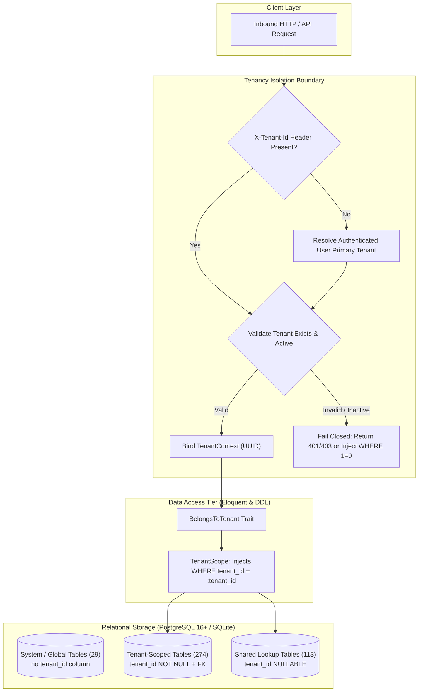
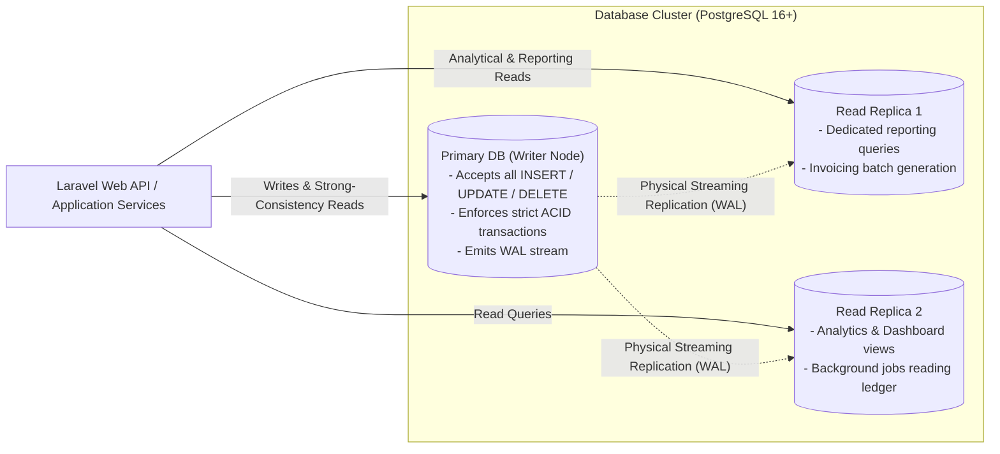
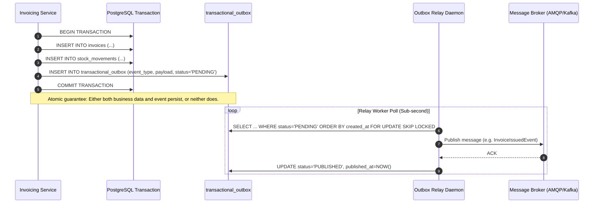
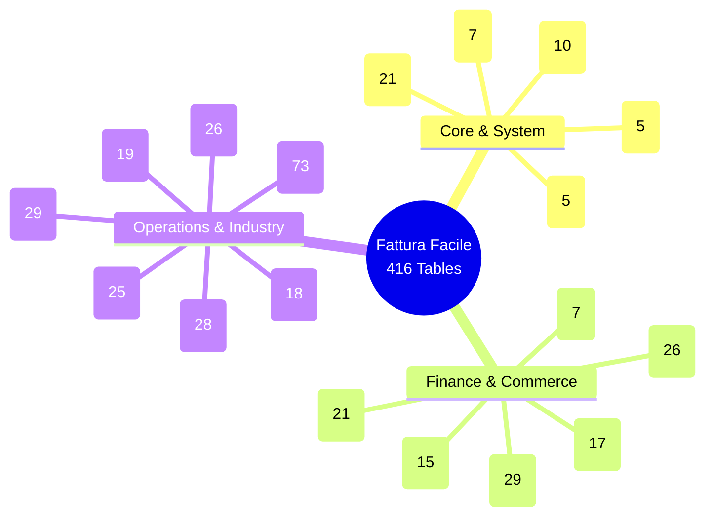

# Fattura Facile Enterprise — Database Platform Architecture & Standards

## 1. Executive Summary & Design Vision

The **Fattura Facile Database Platform** is an enterprise-grade relational persistence tier engineered to support mission-critical ERP operations across Italian and European SMEs and mid-market organizations. The system orchestrates invoicing, electronic interchange (SDI), fiscal accounting, treasury, inventory, procurement, customer relationship management (CRM), manufacturing (MRP), enterprise asset management (EAM), and subscription lifecycle billing.

The database architecture is designed with the following foundational pillars:
- **Clean Architecture & Domain Separation**: Modular bounded contexts with explicit domain boundaries and minimal cyclic dependencies.
- **Strict Shared-Database Multi-Tenancy**: High-density multi-tenancy enforced at both the database schema level (discriminators, compound indexes, cascades) and the application layer (global scopes, fail-closed middleware).
- **Scalable Primary Key Architecture**: Universal non-colliding UUIDv7 keys enabling zero-lock offline generation, clean distributed writes, and friction-free database sharding and migrations.
- **Dual-Engine Polyglot Portability**: 100% dialect compatibility across PostgreSQL 16+ (production clustering with logical replication) and SQLite 3.45+ (local developer test harnesses and edge deployments).
- **Audit Immutability & Event Streaming**: Native support for transactional outbox/inbox patterns and cryptographic append-only audit trails.

---

## 2. Multi-Tenancy Architecture

### 2.1 Isolation Strategy: Shared Database with Tenant Discriminator
The platform implements single-database shared-schema multi-tenancy. Every tenant-owned row includes a `tenant_id` foreign key referencing the global `tenants(id)` registry.



### 2.2 Table Categorization & Classification Rules
The 416 database tables in the schema are categorized into three distinct operational domains:

| Table Category | Count | `tenant_id` Column | Eloquent Global Scope Policy | Key Examples |
| :--- | :--- | :--- | :--- | :--- |
| **System / Global** | 29 | None (`N/A`) | Unscoped. Accessible strictly via internal orchestration services, platform super-admins, or system worker queues. | `tenants`, `users`, `jobs`, `failed_jobs`, `cache`, `sessions`, `password_reset_tokens`, `personal_access_tokens`, `billing_schedule_items`, `general_ledger_lines`, `invoice_qr_bill_data`, `invoice_sdi_metadata` |
| **Tenant-Scoped** | 274 | `VARCHAR(36) NOT NULL` | Strictly scoped via `TenantScope`. Every `SELECT`, `UPDATE`, and `DELETE` automatically receives `WHERE tenant_id = ?`. If unauthenticated, `WHERE 1 = 0` is injected. | `invoices`, `contacts`, `quotes`, `sales_orders`, `purchase_orders`, `warehouses`, `projects`, `eam_fixed_assets`, `esm_tickets`, `hr_employees`, `sub_subscriptions` |
| **Shared Reference Lookup** | 113 | `VARCHAR(36) NULLABLE` | Hybrid fallback scoped. Scoped via `WHERE (tenant_id = ? OR tenant_id IS NULL)`. System baselines have `tenant_id IS NULL`; tenant customizations have explicit `tenant_id`. | `vat_codes`, `payment_terms`, `currencies`, `countries`, `regions`, `units_of_measure`, `chart_of_accounts`, `expense_categories`, `document_statuses`, `workflow_states` |

### 2.3 Tenancy Trait & Scope Implementation Pattern
All business entities inherit from `\Enterprise\Foundation\Models\BaseEnterpriseModel`, leveraging the `\Enterprise\MultiTenant\Concerns\BelongsToTenant` trait:

```php
namespace Enterprise\MultiTenant\Concerns;

use Enterprise\MultiTenant\Scopes\TenantScope;
use Illuminate\Database\Eloquent\Relations\BelongsTo;

trait BelongsToTenant
{
    public static function bootBelongsToTenant(): void
    {
        static::addGlobalScope(new TenantScope());

        static::creating(function ($model) {
            if (empty($model->tenant_id) && app()->bound('tenant.context')) {
                $model->tenant_id = app('tenant.context')->getTenantId();
            }
        });
    }

    public function tenant(): BelongsTo
    {
        return $this->belongsTo(\Enterprise\Core\Models\Tenant::class, 'tenant_id');
    }
}
```

---

## 3. Key Naming & Primary Identifier Conventions

### 3.1 Universally Ordered UUIDv7
To ensure high write-throughput, prevent primary key fragmentation in clustered B-trees, and avoid lock contention in distributed multi-region topologies, the schema adopts **UUIDv7** (RFC 9562) as the canonical primary key identifier:

- **Data Type**: `VARCHAR(36)` (portable across PostgreSQL, MySQL ANSI, SQLite).
- **Format**: `018d3c50-89ab-7000-8000-000000000000` (timestamp-prefixed, 48-bit UNIX millisecond timestamp followed by random entropy).
- **Benefits**:
  - Naturally time-ordered, preventing sequential B-tree page splits on high-frequency write tables (`invoices`, `stock_movements`, `audit_logs`).
  - Safe for client-side / offline ID generation.
  - Zero auto-increment coordination required between sharded nodes.

### 3.2 Exceptional Key Architectures
Four specific operational tables diverge from the single-column UUID pattern for specific infrastructural requirements:
1. `cache` / `cache_locks`: `key VARCHAR(255) PRIMARY KEY` — High-speed string hash lookup.
2. `password_reset_tokens`: `email VARCHAR(255) PRIMARY KEY` — Singleton reset token per identity.
3. `enterprise_audit_ledger`: Composite `PRIMARY KEY (id, event_timestamp)` — Optimized for PostgreSQL native range time partitioning.

### 3.3 Foreign Key & Constraint Naming Standard
All identifiers follow a uniform, deterministic convention:
- **Foreign Keys**: `fk_{source_table}_{foreign_key_column}` (e.g., `fk_invoices_tenant_id`).
- **Unique Indexes**: `uq_{table}_{column1}_{column2}` (e.g., `uq_invoices_tenant_id_number`).
- **Performance Indexes**: `idx_{table}_{column1}_{column2}` (e.g., `idx_invoices_tenant_id_status`).
- **Composite Multi-Tenant Indexes**: Standard rule requires `tenant_id` as the leading column in any multi-column index unless optimizing for a specific cardinality prefix.

---

## 4. CQRS, Read/Write Separation & Partitioning Patterns

### 4.1 Read/Write Connection Separation
To guarantee sub-100ms API response times across high-volume ERP query patterns, the application layer segregates read operations from write mutations:



### 4.2 Large-Table Partitioning Strategy
Tables experiencing unbounded write growth are architected for PostgreSQL native declarative range/list partitioning:

1. **`enterprise_audit_ledger`**:
   - **Strategy**: Range partitioning by `event_timestamp` (Monthly partitions).
   - **Purging / Archival**: Historical partitions older than 10 years (fiscal statutory limitation) can be detached and archived into cold object storage (S3/GCS Parquet format) without executing disruptive row-level `DELETE` statements.
2. **`transactional_outbox` / `transactional_inbox`**:
   - **Active vs Archive Separation**: Once an outbox event is successfully published and acknowledged, a scheduled daemon moves the event into `transactional_outbox_archive` or prunes records older than 14 days, keeping the hot table below 10,000 rows.
3. **`stock_movements` & `customer_ledger_entries`**:
   - High-throughput ledger tables indexed with compound date ranges `(tenant_id, created_at)`.

---

## 5. Event-Driven Architecture: Transactional Outbox & Inbox

To ensure complete consistency between relational database transactions and asynchronous message brokers (e.g., RabbitMQ, Apache Kafka, Amazon SQS, Redis Stream) without two-phase commit (2PC) overhead, the platform utilizes the **Transactional Outbox Pattern**:



### 5.1 Outbox Table Schema Architecture
The outbox schema features exponential backoff, dead-letter retry limits, and correlation tracing:
- `id`: UUIDv7 primary key.
- `tenant_id`: Scoped tenant identifier.
- `event_type`: Dot-notated string (e.g., `invoicing.invoice.finalized`, `sdi.invoice.delivered`).
- `aggregate_type`: Entity domain (e.g., `Invoice`, `Payment`).
- `aggregate_id`: Entity UUID.
- `payload`: Structured JSON document.
- `headers`: Tracing context (`traceparent`, `correlation_id`, `causation_id`).
- `retry_count`: Incremented upon delivery error.
- `retry_after`: Timestamp regulating backoff delay.
- `status`: State machine: `PENDING` -> `PROCESSING` -> `PUBLISHED` / `FAILED`.

---

## 6. Audit Trail & Fiscal Compliance Safeguards

### 6.1 Enterprise Audit Ledger (`enterprise_audit_ledger`)
Under European accounting regulations (such as Italian DPR 633/72 and Swiss MWSTG / GeBüV), system audit logs must satisfy non-repudiation and cryptographic integrity:
- **Append-Only Immutability**: Enforced at the database engine level via trigger denying `UPDATE` and `DELETE` on operational ledger rows:
  ```sql
  CREATE OR REPLACE FUNCTION enforce_audit_ledger_immutability()
  RETURNS TRIGGER AS $$
  BEGIN
      RAISE EXCEPTION 'Audit ledger records are strictly immutable and cannot be updated or deleted.';
  END;
  $$ LANGUAGE plpgsql;
  ```
- **Cryptographic Chaining**: Each audit row contains a `record_hash` and a `previous_record_hash`, creating an unalterable Merkle chain per tenant ledger.

### 6.2 Fiscal Deletion Protections (`ON DELETE RESTRICT`)
In stark contrast to traditional web applications where cascade deletion is standard, fiscal enterprise records implement strict referential locks:
- Foreign keys from invoices, payments, quotes, credit notes, and passive invoices referencing master contacts or companies are configured with `ON DELETE RESTRICT`.
- A customer or vendor record cannot be purged if historical fiscal documents exist.
- Soft deletion (`deleted_at TIMESTAMP`) is deployed across 94 high-level domain entities to preserve historical integrity while filtering records from active user interfaces.

---

## 7. Clean Architecture Module Map

The 416 database tables are structured across 18 specialized architectural domains:



Each domain is fully detailed with field-level data dictionaries, relationship mappings, and indexing strategies in [`docs/modules/`](./docs/modules/).
