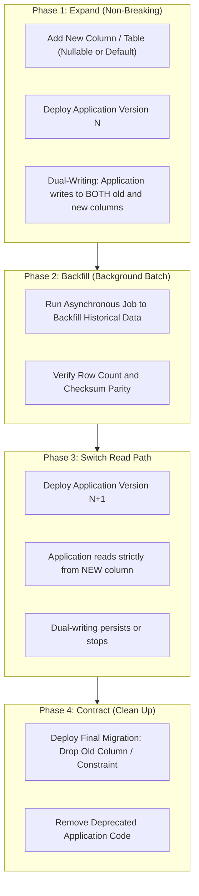

# Fattura Facile Enterprise — Database Migration & Versioning Guidelines

## 1. Migration Philosophy & Standards

In an enterprise ERP platform running mission-critical operations for thousands of concurrent business tenants, database schema migrations must adhere to the highest standard of reliability, reproducibility, and safety. 

### Core Principles
1. **Single Source of Truth**: Laravel migration scripts located under `database/migrations` represent the canonical chronological evolution of the database.
2. **Deterministic & Idempotent**: Migrations must produce the exact same schema structure regardless of the target engine (PostgreSQL 16+ or SQLite 3.45+).
3. **Reversibility (`up()` and `down()`)**: Every migration introducing changes must provide a mathematically and logically sound `down()` method capable of rolling back the alterations cleanly.
4. **Zero-Downtime Deployment (Expand/Contract Pattern)**: Schema evolutions in live production environments must never lock active operational tables or break running web workers during phased rolling deployments.

---

## 2. Zero-Downtime Deployment: The Expand/Contract Pattern

Directly renaming columns or dropping constraints in an active production database causes instantaneous downtime or crashes in web application workers executing in-flight transactions. The **Expand/Contract (Parallel Run)** methodology is mandatory for breaking schema changes.



### 2.1 Rules for Safe Online Alterations
1. **Never Rename Columns in a Single Migration**:
   - `RENAME COLUMN` breaks running application instances that still expect the old column name.
   - *Alternative*: Add the new column, dual-write in Eloquent model observers, backfill, switch readers, then drop the legacy column.
2. **Adding NOT NULL Columns**:
   - Adding a column with `NOT NULL` without a default value fails immediately if the table has existing rows.
   - *Alternative*: Add the column as `nullable()`, run a backfill batch command to populate default values, and then alter the column to `NOT NULL` in a separate migration.
3. **Concurrent Index Creation in Production (PostgreSQL)**:
   - Creating an index on a table with millions of rows locks the table against writes (`CREATE INDEX`).
   - Use raw SQL statements with concurrent indexing:
     ```php
     if (DB::getDriverName() === 'pgsql') {
         DB::statement('CREATE INDEX CONCURRENTLY idx_invoices_tenant_status ON invoices (tenant_id, status);');
     } else {
         Schema::table('invoices', function (Blueprint $table) {
             $table->index(['tenant_id', 'status'], 'idx_invoices_tenant_status');
         });
     }
     ```

---

## 3. Multi-Tenant Migration Rules & Pitfalls

### 3.1 Strict Foreign Key & Tenant Scoping Rule
Every new business table created in a migration must explicitly declare:
1. `tenant_id` as a `VARCHAR(36)` foreign key.
2. A foreign key constraint referencing `tenants(id)`.
3. An explicit index on `tenant_id` or a compound index with `tenant_id` as the leading column.

```php
// Good - Enterprise Multi-Tenant Standard
Schema::create('custom_tenant_reports', function (Blueprint $table) {
    $table->uuid('id')->primary();
    $table->uuid('tenant_id');
    $table->string('report_name');
    $table->string('status', 32);
    $table->timestamps();
    $table->softDeletes();

    $table->foreign('tenant_id')
          ->references('id')
          ->on('tenants')
          ->onDelete('cascade');

    $table->index('tenant_id');
    $table->unique(['tenant_id', 'report_name']);
});
```

### 3.2 The Unique Constraint Multi-Tenant Anti-Pattern
> [!CAUTION]
> **Data Collision Hazard**: Never create a single-column unique constraint on business identifiers in tenant-scoped tables!
> 
> ```php
> // INCORRECT: Prevents Tenant B from using invoice number 'INV-2026-001' if Tenant A used it!
> $table->string('invoice_number')->unique();
> 
> // CORRECT: Uniqueness is scoped per tenant
> $table->unique(['tenant_id', 'invoice_number']);
> ```

---

## 4. Migration Execution & Operational Commands

### 4.1 Running Migrations

#### Local Development & Edge SQLite
```bash
# Execute all pending migrations
php artisan migrate

# Check migration status and batch execution order
php artisan migrate:status

# Roll back the last batch
php artisan migrate:rollback

# Refresh entire database with complete seeders
php artisan migrate:fresh --seed
```

#### Production PostgreSQL Environment
```bash
# Force execution in production mode with isolation
php artisan migrate --force

# Preview the exact SQL DDL before execution (Dry Run)
php artisan migrate --pretend
```

### 4.2 Handling Engine Differences (PostgreSQL vs SQLite)

| Feature | PostgreSQL 16+ (Production) | SQLite 3.45+ (Local / Testing) | Migration Guideline |
| :--- | :--- | :--- | :--- |
| **Dropping Foreign Keys** | Supported natively: `ALTER TABLE ... DROP CONSTRAINT` | Limited; requires table recreation or modern SQLite 3.35+ `ALTER TABLE DROP COLUMN` | Wrap schema drops in engine driver checks or write defensive rollback methods. |
| **Concurrent Indexes** | Supported via `CREATE INDEX CONCURRENTLY` | Unsupported (SQLite is single-writer file lock) | Detect driver with `DB::getDriverName() === 'pgsql'`. |
| **Partitioning** | Supported natively via declarative partition tables | Unsupported | Partition tables at the physical PostgreSQL tier; define base tables in Eloquent. |
| **UUID Generation** | Native `uuid_generate_v7()` or application-provided | Handled uniformly by application layer (Laravel UUIDv7) | Always generate UUIDv7 strings within the PHP application service tier. |

---

## 5. Rollback Strategies & Incident Response

### 5.1 Automated Pre-Flight Validation
Before applying any migration to production staging or cluster:
1. Run `php artisan migrate --pretend` to generate the raw DDL log.
2. Verify with database architects that no table locks (`EXCLUSIVE LOCK`) will be held longer than 200ms.
3. Verify that a complete snapshot backup is recorded via the automated tenant backup engine (`tenant_backups`).

### 5.2 Rollback Playbook
If a migration fails mid-execution or causes unexpected query plan degradation:
1. **Immediate Step**: If the deployment was executed within an expand phase, no data is corrupted. Direct the application router back to version N.
2. **Execute Rollback Command**:
   ```bash
   php artisan migrate:rollback --step=1 --force
   ```
3. **If Schema State is Inconsistent**:
   - Inspect the `migrations` system table:
     ```sql
     SELECT id, migration, batch FROM migrations ORDER BY id DESC LIMIT 5;
     ```
   - Manually reconcile any partial DDL execution before retrying.
