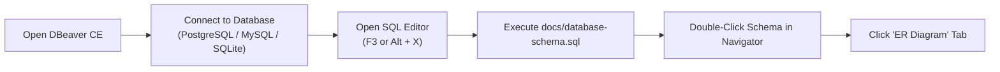

# Fattura Facile ERP — Enterprise Database Schema & Architecture

This document provides the authoritative architectural schema breakdown and multi-tenancy reference for the **Fattura Facile** enterprise ERP database. It serves as the companion analysis to [`docs/database-schema.sql`](file:///c:/dev/fattura-facile/web-api/docs/database-schema.sql), which contains the complete, topologically-ordered SQL DDL schema ready for native import into **DBeaver Community Edition** (and other ER modeling tools).

---

## Documentation Navigation & Architecture Library

| Resource | Path | Description |
| :--- | :--- | :--- |
| **System Architecture Guide** | [`ARCHITECTURE.md`](./ARCHITECTURE.md) | Multi-tenancy isolation models, UUIDv7 conventions, CQRS read/write splitting, and event streaming. |
| **Migration & Versioning Guidelines** | [`MIGRATIONS.md`](./MIGRATIONS.md) | Up/down workflow, zero-downtime expand/contract patterns, and production deployment checklists. |
| **Complete Schema Reference Index** | [`docs/SCHEMA_INDEX.md`](./docs/SCHEMA_INDEX.md) | Master directory linking all 416 database tables across 17 modular architectural domains. |
| **Complete Relational Diagram** | [`main.md`](./main.md) | Authoritative Mermaid Class Diagram defining all 416 tables and 1,062 foreign key relationships. |
| **Modular Domain Dictionaries** | [`docs/modules/`](./docs/modules/) | Field-level data dictionaries, data types, nullability, defaults, and foreign keys per module. |

---

## 1. Architectural Overview & Multi-Tenancy Framework

### 1.1 Tenant Isolation Model
- **Architecture**: Shared Database / Single Database Multi-Tenancy with Discriminator Column (`tenant_id`).
- **Authoritative Scope**: Implemented via `\Enterprise\MultiTenant\Scopes\TenantScope` (aliased in `\App\Models\Scopes\TenantScope`).
- **Trait Enforcement**: Implemented via `\Enterprise\MultiTenant\Concerns\BelongsToTenant` (aliased in `\App\Models\Concerns\BelongsToTenant`) and applied across all models extending `\Enterprise\Foundation\Models\BaseEnterpriseModel`.
- **Context Lifecycle**: Resolved per request via `\App\Http\Middleware\IdentifyTenant` from the `X-Tenant-Id` HTTP header (or fallback to user primary tenant) and registered into `\App\Services\Tenancy\TenantContext`.
- **Fail-Closed Behavior**: When an operation executes without an active tenant context, `TenantScope` injects `WHERE 1 = 0` on operational tables to prevent accidental cross-tenant data exposure.

### 1.2 Table Categorization & Scoping Rules
The 416 database tables are divided into three distinct operational categories based on column-level nullability and multi-tenant scoping semantics:

1. **System / Global Tables (29 Tables)**:
   - Tables managing authentication, background jobs, caching, system configuration, global tenants, and parent-linked 1:1 or dependent item rows.
   - Contain **no** `tenant_id` column.
   - Subdivided into:
     - *Infrastructural System Tables (14 tables)*: `tenants`, `users`, `cache`, `cache_locks`, `sessions`, `jobs`, `failed_jobs`, `job_batches`, `password_reset_tokens`, `personal_access_tokens`, `exchange_rates`, `lookup_categories`, `document_sequences`, `translations`.
     - *Dependent Child Items Scoped Via Parent FK (15 tables)*: `contact_addresses`, `discount_policy_rules`, `billing_schedule_items`, `bom_items`, `expense_items`, `general_ledger_lines`, `goods_receipt_items`, `invoice_qr_bill_data`, `invoice_sdi_metadata`, `payment_term_installments`, `pos_sale_items`, `price_list_items`, `production_order_stages`, `purchase_order_items`, `subscription_items`, `work_order_lines`.
   - Scoping Behavior: Unscoped in Eloquent; child tables derive tenant context transitively through their primary parent foreign key.

2. **Tenant-Scoped Tables (274 Tables)**:
   - High-volume transactional, operational, and master entities strictly owned by a specific organization.
   - Contain `tenant_id VARCHAR(36) NOT NULL` with `FOREIGN KEY (tenant_id) REFERENCES tenants(id) ON DELETE CASCADE`.
   - Automatically filtered by `TenantScope::apply()` with `WHERE tenant_id = ?`.
   - Examples: `invoices`, `invoice_items`, `quotes`, `sales_orders`, `purchase_orders`, `contacts`, `warehouses`, `stock_items`, `projects`, `eam_fixed_assets`, `esm_tickets`, `hr_employees`, `sub_subscriptions`, `transactional_outbox`.

3. **Shared Reference Lookup & Config Tables (113 Tables)**:
   - Catalogs, standard classification registers, and baseline templates that support system-wide presets with tenant-specific custom overrides.
   - Contain `tenant_id VARCHAR(36) NULL` (nullable).
   - If `tenant_id IS NULL`, the row represents an official system baseline (e.g., standard Italian DPR 633/72 VAT codes, ISO currencies, standard chart of accounts).
   - If `tenant_id` is populated, the row represents a customized or private override for that specific organization.
   - `TenantScope` executes: `WHERE (tenant_id = ? OR tenant_id IS NULL)`.
   - Examples: `vat_codes`, `payment_terms`, `currencies`, `countries`, `regions`, `units_of_measure`, `chart_of_accounts`, `bank_accounts`, `expense_categories`, `document_statuses`, `workflow_states`.

### 1.3 Key & Identifier Conventions
- **Primary Keys**: Universally **UUIDv7** strings (`VARCHAR(36)`), managed by `Enterprise\Foundation\Concerns\HasUuidV7`. This eliminates auto-increment collision risks during tenant database shard splits and backup/restore cycles.
- **Special Non-UUID Primary Keys** (4 tables):
  - `cache` and `cache_locks`: `key VARCHAR(255) PRIMARY KEY`
  - `password_reset_tokens`: `email VARCHAR(255) PRIMARY KEY`
  - `enterprise_audit_ledger`: Composite `PRIMARY KEY (id, event_timestamp)` optimized for immutable append-only ledger partitioning.

---

## 2. DBeaver Community Edition — Native ER Diagram Import Guide

The schema file [`docs/database-schema.sql`](file:///c:/dev/fattura-facile/web-api/docs/database-schema.sql) is topologically organized so that DBeaver Community Edition automatically resolves all primary-foreign key connectors into an interactive relational graph without manual line wiring.



### Step-by-Step Instructions:
1. **Connect to Scratch or Development Database**:
   - Open DBeaver Community Edition.
   - Create a new connection to your target engine (e.g. PostgreSQL `127.0.0.1:5432/erp_db`, or a clean SQLite / MySQL scratch schema).
2. **Open and Run the SQL Schema File**:
   - In DBeaver, press `Ctrl + O` (or **File > Open File**) and choose `docs/database-schema.sql`.
   - Alternatively, open an SQL Editor (`F3`) and paste the file content.
   - Run the script by pressing `Alt + X` (**Execute SQL Script**).
   - The script creates 416 tables in topological order, establishes 696 foreign key constraints, declares composite unique constraints, and creates multi-tenant performance indexes.
3. **Generate & View the Interactive ER Diagram**:
   - In the **Database Navigator** pane on the left, navigate to your database and double-click the **public** schema (or root database folder).
   - In the central main window, switch to the **"ER Diagram"** tab.
   - DBeaver will automatically parse the 696 foreign keys and render the complete enterprise graph with Crow's Foot cardinality connectors.
4. **Recommended DBeaver ER Diagram Settings**:
   - **Layout**: Right-click canvas -> **Layout > Hierarchical Layout** or **Orthogonal**.
   - **Grouping**: Select tables by domain (e.g. Sales, Procurement, MRP, ESM) -> Right-click -> **Create Logical Table Group**.
   - **Detail Level**: Toggle between *Attributes (Full)*, *Keys Only*, or *Entity Names Only* depending on zoom scale.

---

## 3. Multi-Tenancy & Schema Integrity Matrix

The following matrix details all 416 database tables, their associated Eloquent models, scoping rules, tenant discriminator keys, primary keys, and critical constraints.

| Table Name | Eloquent Model | Scope | Tenant Discriminator Key | Primary Key Type | Key Indexes & Uniques |
| :--- | :--- | :--- | :--- | :--- | :--- |
| `accounting_anomalies` | `Enterprise Model (Dynamic/Module)` | Tenant-Scoped | `tenant_id` | UUID (v7/v4 string) | INDEX(tenant_id) |
| `accrual_entries` | `Enterprise Model (Dynamic/Module)` | Tenant-Scoped | `tenant_id` | UUID (v7/v4 string) | INDEX(tenant_id) |
| `alerts` | `Alert` | Tenant-Scoped | `tenant_id` | UUID (v7/v4 string) | IDX(alertable_type, alertable_id); IDX(tenant_id, is_active) |
| `appointment_attendees` | `AppointmentAttendee` | Tenant-Scoped | `tenant_id` | UUID (v7/v4 string) | UNIQUE(appointment_id, user_id); IDX(tenant_id, appointment_id); IDX(tenant_id, user_id) |
| `appointments` | `Appointment` | Tenant-Scoped | `tenant_id` | UUID (v7/v4 string) | UNIQUE(tenant_id, appointment_number); IDX(tenant_id, contact_id); IDX(tenant_id, is_portal_visible) |
| `approval_decisions` | `Enterprise Model (Dynamic/Module)` | Tenant-Scoped | `tenant_id` | UUID (v7/v4 string) | INDEX(tenant_id) |
| `approval_matrix_rules` | `Enterprise Model (Dynamic/Module)` | Tenant-Scoped | `tenant_id` | UUID (v7/v4 string) | INDEX(tenant_id) |
| `approval_matrix_tiers` | `Enterprise Model (Dynamic/Module)` | Tenant-Scoped | `tenant_id` | UUID (v7/v4 string) | IDX(approval_matrix_id, tier_level) |
| `approval_matrixes` | `Enterprise Model (Dynamic/Module)` | Tenant-Scoped | `tenant_id` | UUID (v7/v4 string) | UNIQUE(tenant_id, code); IDX(tenant_id, target_entity_type, is_active) |
| `approval_status_translations` | `ApprovalStatusTranslation` | Shared Reference Lookup | `tenant_id (nullable)` | UUID (v7/v4 string) | UNIQUE(approval_status_id, locale) |
| `approval_statuses` | `ApprovalStatus` | Shared Reference Lookup | `tenant_id (nullable)` | UUID (v7/v4 string) | UNIQUE(code) |
| `approval_tokens` | `Enterprise Model (Dynamic/Module)` | Tenant-Scoped | `tenant_id` | UUID (v7/v4 string) | UNIQUE(token_hash); IDX(token_hash, used_at, expires_at) |
| `attachments` | `Attachment` | Tenant-Scoped | `tenant_id` | UUID (v7/v4 string) | IDX(attachable_type, attachable_id); IDX(tenant_id, attachable_type, attachable_id) |
| `audit_logs` | `AuditLog` | Tenant-Scoped | `tenant_id` | UUID (v7/v4 string) | IDX(tenant_id, created_at) |
| `bank_account_balances` | `Enterprise Model (Dynamic/Module)` | Tenant-Scoped | `tenant_id` | UUID (v7/v4 string) | UNIQUE(tenant_id, bank_account_id, balance_date) |
| `bank_account_signatories` | `Enterprise Model (Dynamic/Module)` | Tenant-Scoped | `tenant_id` | UUID (v7/v4 string) | IDX(tenant_id, bank_account_id, is_active) |
| `bank_accounts` | `BankAccount` | Tenant-Scoped | `tenant_id` | UUID (v7/v4 string) | IDX(tenant_id, currency) |
| `bank_branches` | `Enterprise Model (Dynamic/Module)` | Tenant-Scoped | `tenant_id` | UUID (v7/v4 string) | IDX(tenant_id, bank_name) |
| `bank_connections` | `Enterprise Model (Dynamic/Module)` | Tenant-Scoped | `tenant_id` | UUID (v7/v4 string) | INDEX(tenant_id) |
| `bank_guarantees` | `Enterprise Model (Dynamic/Module)` | Tenant-Scoped | `tenant_id` | UUID (v7/v4 string) | UNIQUE(tenant_id, guarantee_number) |
| `bank_reconciliations` | `Enterprise Model (Dynamic/Module)` | Tenant-Scoped | `tenant_id` | UUID (v7/v4 string) | IDX(tenant_id, bank_account_id, period_end_date) |
| `bank_statement_lines` | `BankStatementLine` | Tenant-Scoped | `tenant_id` | UUID (v7/v4 string) | IDX(tenant_id, reconciled) |
| `bank_statements` | `BankStatement` | Tenant-Scoped | `tenant_id` | UUID (v7/v4 string) | UNIQUE(tenant_id, content_hash); IDX(tenant_id, source_format); IDX(tenant_id, status) |
| `bank_transactions` | `BankTransaction` | Tenant-Scoped | `tenant_id` | UUID (v7/v4 string) | IDX(tenant_id, booking_date) |
| `billable_activities` | `BillableActivity` | Tenant-Scoped | `tenant_id` | UUID (v7/v4 string) | INDEX(tenant_id) |
| `billing_schedule_items` | `Enterprise Model (Dynamic/Module)` | System / Global | `None` | UUID (v7/v4 string) | None (No tenant_id) |
| `billing_schedules` | `Enterprise Model (Dynamic/Module)` | Tenant-Scoped | `tenant_id` | UUID (v7/v4 string) | UNIQUE(tenant_id, schedule_number) |
| `bills_of_materials` | `BillOfMaterial` | Tenant-Scoped | `tenant_id` | UUID (v7/v4 string) | INDEX(tenant_id) |
| `bom_items` | `Enterprise Model (Dynamic/Module)` | System / Global | `None` | UUID (v7/v4 string) | None (No tenant_id) |
| `business_calendar_holidays` | `Enterprise Model (Dynamic/Module)` | Tenant-Scoped | `tenant_id` | UUID (v7/v4 string) | UNIQUE(business_calendar_id, holiday_date) |
| `business_calendars` | `Enterprise Model (Dynamic/Module)` | Tenant-Scoped | `tenant_id` | UUID (v7/v4 string) | IDX(tenant_id, is_default) |
| `cache` | `Enterprise Model (Dynamic/Module)` | System / Global | `None` | VARCHAR(255) (key) | None (No tenant_id) |
| `cache_locks` | `Enterprise Model (Dynamic/Module)` | System / Global | `None` | VARCHAR(255) (key) | None (No tenant_id) |
| `carbon_ledger` | `Enterprise Model (Dynamic/Module)` | Tenant-Scoped | `tenant_id` | UUID (v7/v4 string) | INDEX(tenant_id) |
| `cash_forecast_lines` | `Enterprise Model (Dynamic/Module)` | Tenant-Scoped | `tenant_id` | UUID (v7/v4 string) | IDX(tenant_id, projected_date, flow_type) |
| `cash_forecasts` | `Enterprise Model (Dynamic/Module)` | Tenant-Scoped | `tenant_id` | UUID (v7/v4 string) | IDX(tenant_id, calculation_date) |
| `cash_pools` | `Enterprise Model (Dynamic/Module)` | Tenant-Scoped | `tenant_id` | UUID (v7/v4 string) | INDEX(tenant_id) |
| `chart_of_accounts` | `ChartOfAccount` | Tenant-Scoped | `tenant_id` | UUID (v7/v4 string) | UNIQUE(tenant_id, code) |
| `conformity_certificates` | `ConformityCertificate` | Tenant-Scoped | `tenant_id` | UUID (v7/v4 string) | INDEX(tenant_id) |
| `construction_sites` | `ConstructionSite` | Tenant-Scoped | `tenant_id` | UUID (v7/v4 string) | UNIQUE(tenant_id, code) |
| `contact_addresses` | `ContactAddress` | System / Global | `None` | UUID (v7/v4 string) | IDX(contact_id, type) |
| `contact_categories` | `ContactCategory` | Shared Reference Lookup | `tenant_id (nullable)` | UUID (v7/v4 string) | UNIQUE(code) |
| `contact_category_translations` | `ContactCategoryTranslation` | Shared Reference Lookup | `tenant_id (nullable)` | UUID (v7/v4 string) | UNIQUE(contact_category_id, locale) |
| `contact_type_translations` | `ContactTypeTranslation` | Shared Reference Lookup | `tenant_id (nullable)` | UUID (v7/v4 string) | UNIQUE(contact_type_id, locale) |
| `contact_types` | `ContactType` | Shared Reference Lookup | `tenant_id (nullable)` | UUID (v7/v4 string) | UNIQUE(code) |
| `contacts` | `Contact` | Tenant-Scoped | `tenant_id` | UUID (v7/v4 string) | IDX(tenant_id, country); IDX(tenant_id, fiscal_code); IDX(tenant_id, type) |
| `cost_centers` | `Enterprise Model (Dynamic/Module)` | Tenant-Scoped | `tenant_id` | UUID (v7/v4 string) | UNIQUE(tenant_id, company_id, code) |
| `countries` | `Country` | Shared Reference Lookup | `tenant_id (nullable)` | UUID (v7/v4 string) | UNIQUE(iso_code_2); UNIQUE(iso_code_3); UNIQUE(numeric_code) |
| `country_translations` | `CountryTranslation` | Shared Reference Lookup | `tenant_id (nullable)` | UUID (v7/v4 string) | UNIQUE(country_id, locale) |
| `crm_accounts` | `Enterprise Model (Dynamic/Module)` | Tenant-Scoped | `tenant_id` | UUID (v7/v4 string) | UNIQUE(tenant_id, account_number); IDX(tenant_id, customer_health_index); IDX(tenant_id, tier, status) |
| `crm_activities` | `Enterprise Model (Dynamic/Module)` | Tenant-Scoped | `tenant_id` | UUID (v7/v4 string) | IDX(tenant_id, related_type, related_id); IDX(tenant_id, status, due_date) |
| `crm_campaign_members` | `Enterprise Model (Dynamic/Module)` | Tenant-Scoped | `tenant_id` | UUID (v7/v4 string) | IDX(tenant_id, campaign_id, status) |
| `crm_campaign_types` | `Enterprise Model (Dynamic/Module)` | Tenant-Scoped | `tenant_id` | UUID (v7/v4 string) | UNIQUE(tenant_id, code); IDX(tenant_id, is_active) |
| `crm_campaigns` | `Enterprise Model (Dynamic/Module)` | Tenant-Scoped | `tenant_id` | UUID (v7/v4 string) | UNIQUE(tenant_id, code); IDX(tenant_id, status, start_date) |
| `crm_contact_roles` | `Enterprise Model (Dynamic/Module)` | Tenant-Scoped | `tenant_id` | UUID (v7/v4 string) | IDX(tenant_id, account_id, role); IDX(tenant_id, contact_id) |
| `crm_customer_health_profiles` | `Enterprise Model (Dynamic/Module)` | Tenant-Scoped | `tenant_id` | UUID (v7/v4 string) | UNIQUE(tenant_id, account_id); IDX(tenant_id, health_index, churn_risk_indicator) |
| `crm_forecasts` | `Enterprise Model (Dynamic/Module)` | Tenant-Scoped | `tenant_id` | UUID (v7/v4 string) | UNIQUE(tenant_id, user_id, period); IDX(tenant_id, period, status) |
| `crm_lead_sources` | `Enterprise Model (Dynamic/Module)` | Tenant-Scoped | `tenant_id` | UUID (v7/v4 string) | UNIQUE(tenant_id, code); IDX(tenant_id, is_active) |
| `crm_leads` | `Enterprise Model (Dynamic/Module)` | Tenant-Scoped | `tenant_id` | UUID (v7/v4 string) | IDX(tenant_id, company_name, email); IDX(tenant_id, status, score) |
| `crm_opportunities` | `Enterprise Model (Dynamic/Module)` | Tenant-Scoped | `tenant_id` | UUID (v7/v4 string) | UNIQUE(tenant_id, opportunity_number); IDX(tenant_id, amount); IDX(tenant_id, expected_close_date) |
| `crm_opportunity_line_items` | `Enterprise Model (Dynamic/Module)` | Tenant-Scoped | `tenant_id` | UUID (v7/v4 string) | IDX(tenant_id, opportunity_id) |
| `crm_opportunity_stages` | `Enterprise Model (Dynamic/Module)` | Tenant-Scoped | `tenant_id` | UUID (v7/v4 string) | UNIQUE(tenant_id, code); IDX(tenant_id, sequence) |
| `currencies` | `Currency` | Shared Reference Lookup | `tenant_id (nullable)` | UUID (v7/v4 string) | UNIQUE(code) |
| `currency_translations` | `CurrencyTranslation` | Shared Reference Lookup | `tenant_id (nullable)` | UUID (v7/v4 string) | UNIQUE(currency_id, locale) |
| `customer_agreements` | `Enterprise Model (Dynamic/Module)` | Tenant-Scoped | `tenant_id` | UUID (v7/v4 string) | UNIQUE(tenant_id, agreement_number) |
| `customer_credit_profiles` | `Enterprise Model (Dynamic/Module)` | Tenant-Scoped | `tenant_id` | UUID (v7/v4 string) | UNIQUE(tenant_id, customer_id) |
| `customer_groups` | `Enterprise Model (Dynamic/Module)` | Tenant-Scoped | `tenant_id` | UUID (v7/v4 string) | UNIQUE(tenant_id, code) |
| `customer_ledger` | `Enterprise Model (Dynamic/Module)` | Tenant-Scoped | `tenant_id` | UUID (v7/v4 string) | INDEX(tenant_id) |
| `customer_ledger_entries` | `Enterprise Model (Dynamic/Module)` | Tenant-Scoped | `tenant_id` | UUID (v7/v4 string) | IDX(tenant_id, customer_id, entry_date); IDX(tenant_id, status, due_date) |
| `customs_declarations` | `Enterprise Model (Dynamic/Module)` | Tenant-Scoped | `tenant_id` | UUID (v7/v4 string) | UNIQUE(tenant_id, declaration_number) |
| `damage_inspections` | `DamageInspection` | Tenant-Scoped | `tenant_id` | UUID (v7/v4 string) | INDEX(tenant_id) |
| `dashboard_layouts` | `DashboardLayout` | Tenant-Scoped | `tenant_id` | UUID (v7/v4 string) | UNIQUE(tenant_id, user_id, is_default) |
| `delivery_note_items` | `DeliveryNoteItem` | Tenant-Scoped | `tenant_id` | UUID (v7/v4 string) | INDEX(tenant_id) |
| `delivery_notes` | `DeliveryNote` | Tenant-Scoped | `tenant_id` | UUID (v7/v4 string) | UNIQUE(tenant_id, ddt_number); IDX(tenant_id, contact_id); IDX(tenant_id, date) |
| `discount_policies` | `Enterprise Model (Dynamic/Module)` | Tenant-Scoped | `tenant_id` | UUID (v7/v4 string) | UNIQUE(tenant_id, code) |
| `discount_policy_rules` | `Enterprise Model (Dynamic/Module)` | System / Global | `None` | UUID (v7/v4 string) | None (No tenant_id) |
| `document_emails` | `DocumentEmail` | Tenant-Scoped | `tenant_id` | UUID (v7/v4 string) | IDX(emailable_type, emailable_id) |
| `document_events` | `DocumentEvent` | Tenant-Scoped | `tenant_id` | UUID (v7/v4 string) | IDX(eventable_type, eventable_id) |
| `document_sequences` | `DocumentSequence` | Tenant-Scoped | `tenant_id` | UUID (v7/v4 string) | UNIQUE(tenant_id, document_type, fiscal_year) |
| `document_status_translations` | `DocumentStatusTranslation` | Shared Reference Lookup | `tenant_id (nullable)` | UUID (v7/v4 string) | UNIQUE(document_status_id, locale) |
| `document_statuses` | `DocumentStatus` | Shared Reference Lookup | `tenant_id (nullable)` | UUID (v7/v4 string) | UNIQUE(scope, code) |
| `eam_asset_assignments` | `Enterprise Model (Dynamic/Module)` | Tenant-Scoped | `tenant_id` | UUID (v7/v4 string) | UNIQUE(tenant_id, assignment_number) |
| `eam_asset_categories` | `Enterprise Model (Dynamic/Module)` | Tenant-Scoped | `tenant_id` | UUID (v7/v4 string) | UNIQUE(tenant_id, code) |
| `eam_asset_classes` | `Enterprise Model (Dynamic/Module)` | Tenant-Scoped | `tenant_id` | UUID (v7/v4 string) | UNIQUE(tenant_id, code) |
| `eam_asset_components` | `Enterprise Model (Dynamic/Module)` | Tenant-Scoped | `tenant_id` | UUID (v7/v4 string) | INDEX(tenant_id) |
| `eam_asset_custodians` | `Enterprise Model (Dynamic/Module)` | Tenant-Scoped | `tenant_id` | UUID (v7/v4 string) | INDEX(tenant_id) |
| `eam_asset_disposals` | `Enterprise Model (Dynamic/Module)` | Tenant-Scoped | `tenant_id` | UUID (v7/v4 string) | UNIQUE(tenant_id, disposal_number) |
| `eam_asset_documents` | `Enterprise Model (Dynamic/Module)` | Tenant-Scoped | `tenant_id` | UUID (v7/v4 string) | INDEX(tenant_id) |
| `eam_asset_locations` | `Enterprise Model (Dynamic/Module)` | Tenant-Scoped | `tenant_id` | UUID (v7/v4 string) | UNIQUE(tenant_id, code) |
| `eam_asset_relationships` | `Enterprise Model (Dynamic/Module)` | Tenant-Scoped | `tenant_id` | UUID (v7/v4 string) | UNIQUE(tenant_id, source_asset_id, target_asset_id, relationship_type) |
| `eam_asset_transfers` | `Enterprise Model (Dynamic/Module)` | Tenant-Scoped | `tenant_id` | UUID (v7/v4 string) | UNIQUE(tenant_id, transfer_number) |
| `eam_asset_valuations` | `Enterprise Model (Dynamic/Module)` | Tenant-Scoped | `tenant_id` | UUID (v7/v4 string) | UNIQUE(tenant_id, valuation_number) |
| `eam_depreciation_runs` | `Enterprise Model (Dynamic/Module)` | Tenant-Scoped | `tenant_id` | UUID (v7/v4 string) | UNIQUE(tenant_id, period_code, period_type, ledger_type) |
| `eam_depreciation_schedules` | `Enterprise Model (Dynamic/Module)` | Tenant-Scoped | `tenant_id` | UUID (v7/v4 string) | UNIQUE(tenant_id, asset_id, ledger_type, period_code) |
| `eam_fixed_assets` | `Enterprise Model (Dynamic/Module)` | Tenant-Scoped | `tenant_id` | UUID (v7/v4 string) | UNIQUE(tenant_id, asset_number) |
| `eam_maintenance_activities` | `Enterprise Model (Dynamic/Module)` | Tenant-Scoped | `tenant_id` | UUID (v7/v4 string) | INDEX(tenant_id) |
| `eam_maintenance_plans` | `Enterprise Model (Dynamic/Module)` | Tenant-Scoped | `tenant_id` | UUID (v7/v4 string) | UNIQUE(tenant_id, plan_code) |
| `eam_maintenance_work_orders` | `Enterprise Model (Dynamic/Module)` | Tenant-Scoped | `tenant_id` | UUID (v7/v4 string) | UNIQUE(tenant_id, work_order_number) |
| `eam_project_asset_allocations` | `Enterprise Model (Dynamic/Module)` | Tenant-Scoped | `tenant_id` | UUID (v7/v4 string) | INDEX(tenant_id) |
| `ecommerce_channels` | `EcommerceChannel` | Tenant-Scoped | `tenant_id` | UUID (v7/v4 string) | UNIQUE(tenant_id, name); IDX(tenant_id, is_active) |
| `ecommerce_mappings` | `EcommerceMapping` | Tenant-Scoped | `tenant_id` | UUID (v7/v4 string) | UNIQUE(tenant_id, channel_id, entity_type, remote_id); IDX(channel_id, entity_type, local_id); IDX(channel_id, remote_sku) |
| `ei_inbound_logs` | `EiInboundLog` | Tenant-Scoped | `tenant_id` | UUID (v7/v4 string) | UNIQUE(fingerprint); IDX(invoice_id, created_at) |
| `ei_outbound_logs` | `EiOutboundLog` | Tenant-Scoped | `tenant_id` | UUID (v7/v4 string) | IDX(invoice_id, created_at) |
| `employee_profiles` | `EmployeeProfile` | Tenant-Scoped | `tenant_id` | UUID (v7/v4 string) | UNIQUE(tenant_id, user_id) |
| `enterprise_audit_ledger` | `Enterprise Model (Dynamic/Module)` | Tenant-Scoped | `tenant_id` | Composite (id, event_timestamp) | IDX(tenant_id, resource_type, resource_id, event_timestamp) |
| `enterprise_feature_flags` | `Enterprise Model (Dynamic/Module)` | Tenant-Scoped | `tenant_id` | UUID (v7/v4 string) | IDX(feature_key, tenant_id); IDX(feature_key, user_id) |
| `esm_business_hours_calendars` | `Enterprise Model (Dynamic/Module)` | Tenant-Scoped | `tenant_id` | UUID (v7/v4 string) | UNIQUE(tenant_id, code) |
| `esm_change_requests` | `Enterprise Model (Dynamic/Module)` | Tenant-Scoped | `tenant_id` | UUID (v7/v4 string) | UNIQUE(tenant_id, change_number) |
| `esm_csat_surveys` | `Enterprise Model (Dynamic/Module)` | Tenant-Scoped | `tenant_id` | UUID (v7/v4 string) | INDEX(tenant_id) |
| `esm_incidents` | `Enterprise Model (Dynamic/Module)` | Tenant-Scoped | `tenant_id` | UUID (v7/v4 string) | UNIQUE(tenant_id, incident_number) |
| `esm_knowledge_articles` | `Enterprise Model (Dynamic/Module)` | Tenant-Scoped | `tenant_id` | UUID (v7/v4 string) | UNIQUE(tenant_id, article_number) |
| `esm_parts_consumptions` | `Enterprise Model (Dynamic/Module)` | Tenant-Scoped | `tenant_id` | UUID (v7/v4 string) | INDEX(tenant_id) |
| `esm_problems` | `Enterprise Model (Dynamic/Module)` | Tenant-Scoped | `tenant_id` | UUID (v7/v4 string) | UNIQUE(tenant_id, problem_number) |
| `esm_service_appointments` | `Enterprise Model (Dynamic/Module)` | Tenant-Scoped | `tenant_id` | UUID (v7/v4 string) | UNIQUE(tenant_id, appointment_number) |
| `esm_service_categories` | `Enterprise Model (Dynamic/Module)` | Tenant-Scoped | `tenant_id` | UUID (v7/v4 string) | UNIQUE(tenant_id, code) |
| `esm_service_contracts` | `Enterprise Model (Dynamic/Module)` | Tenant-Scoped | `tenant_id` | UUID (v7/v4 string) | UNIQUE(tenant_id, contract_number) |
| `esm_service_teams` | `Enterprise Model (Dynamic/Module)` | Tenant-Scoped | `tenant_id` | UUID (v7/v4 string) | UNIQUE(tenant_id, code) |
| `esm_service_technicians` | `Enterprise Model (Dynamic/Module)` | Tenant-Scoped | `tenant_id` | UUID (v7/v4 string) | UNIQUE(tenant_id, technician_number) |
| `esm_service_visits` | `Enterprise Model (Dynamic/Module)` | Tenant-Scoped | `tenant_id` | UUID (v7/v4 string) | INDEX(tenant_id) |
| `esm_sla_policies` | `Enterprise Model (Dynamic/Module)` | Tenant-Scoped | `tenant_id` | UUID (v7/v4 string) | UNIQUE(tenant_id, code) |
| `esm_support_plans` | `Enterprise Model (Dynamic/Module)` | Tenant-Scoped | `tenant_id` | UUID (v7/v4 string) | UNIQUE(tenant_id, code) |
| `esm_ticket_time_entries` | `Enterprise Model (Dynamic/Module)` | Tenant-Scoped | `tenant_id` | UUID (v7/v4 string) | INDEX(tenant_id) |
| `esm_tickets` | `Enterprise Model (Dynamic/Module)` | Tenant-Scoped | `tenant_id` | UUID (v7/v4 string) | UNIQUE(tenant_id, ticket_number) |
| `esm_work_order_items` | `Enterprise Model (Dynamic/Module)` | Tenant-Scoped | `tenant_id` | UUID (v7/v4 string) | INDEX(tenant_id) |
| `esm_work_orders` | `Enterprise Model (Dynamic/Module)` | Tenant-Scoped | `tenant_id` | UUID (v7/v4 string) | UNIQUE(tenant_id, work_order_number) |
| `exchange_rates` | `ExchangeRate` | System / Global | `None` | UUID (v7/v4 string) | UNIQUE(source, target, effective_date) |
| `expense_attachments` | `ExpenseAttachment` | Tenant-Scoped | `tenant_id` | UUID (v7/v4 string) | IDX(tenant_id, expense_id) |
| `expense_categories` | `ExpenseCategory` | Shared Reference Lookup | `tenant_id (nullable)` | UUID (v7/v4 string) | UNIQUE(code) |
| `expense_category_translations` | `ExpenseCategoryTranslation` | Shared Reference Lookup | `tenant_id (nullable)` | UUID (v7/v4 string) | UNIQUE(expense_category_id, locale) |
| `expense_items` | `Enterprise Model (Dynamic/Module)` | System / Global | `None` | UUID (v7/v4 string) | None (No tenant_id) |
| `expense_reports` | `Enterprise Model (Dynamic/Module)` | Tenant-Scoped | `tenant_id` | UUID (v7/v4 string) | IDX(tenant_id, user_id, status) |
| `expenses` | `Expense` | Tenant-Scoped | `tenant_id` | UUID (v7/v4 string) | UNIQUE(tenant_id, expense_number); IDX(tenant_id, accounting_exported_at); IDX(tenant_id, category_id) |
| `failed_jobs` | `Enterprise Model (Dynamic/Module)` | System / Global | `None` | UUID (v7/v4 string) | UNIQUE(uuid); IDX(connection, queue, failed_at) |
| `fee_notes` | `FeeNote` | Tenant-Scoped | `tenant_id` | UUID (v7/v4 string) | UNIQUE(tenant_id, note_number) |
| `financial_closing_runs` | `Enterprise Model (Dynamic/Module)` | Tenant-Scoped | `tenant_id` | UUID (v7/v4 string) | INDEX(tenant_id) |
| `fiscal_periods` | `Enterprise Model (Dynamic/Module)` | Tenant-Scoped | `tenant_id` | UUID (v7/v4 string) | UNIQUE(fiscal_year_id, period_number) |
| `fiscal_years` | `Enterprise Model (Dynamic/Module)` | Tenant-Scoped | `tenant_id` | UUID (v7/v4 string) | UNIQUE(tenant_id, company_id, year_code) |
| `forecast_scenarios` | `Enterprise Model (Dynamic/Module)` | Tenant-Scoped | `tenant_id` | UUID (v7/v4 string) | UNIQUE(tenant_id, code) |
| `fx_positions` | `Enterprise Model (Dynamic/Module)` | Tenant-Scoped | `tenant_id` | UUID (v7/v4 string) | UNIQUE(tenant_id, currency, as_of_date) |
| `fx_revaluations` | `Enterprise Model (Dynamic/Module)` | Tenant-Scoped | `tenant_id` | UUID (v7/v4 string) | INDEX(tenant_id) |
| `general_ledger_entries` | `GeneralLedgerEntry` | Tenant-Scoped | `tenant_id` | UUID (v7/v4 string) | UNIQUE(tenant_id, entry_number); IDX(reference_type, reference_id) |
| `general_ledger_lines` | `GeneralLedgerLine` | System / Global | `None` | UUID (v7/v4 string) | None (No tenant_id) |
| `goods_receipt_items` | `GoodsReceiptItem` | System / Global | `None` | UUID (v7/v4 string) | None (No tenant_id) |
| `goods_receipts` | `GoodsReceipt` | Tenant-Scoped | `tenant_id` | UUID (v7/v4 string) | UNIQUE(tenant_id, receipt_number) |
| `hr_attendance_records` | `Enterprise Model (Dynamic/Module)` | Tenant-Scoped | `tenant_id` | UUID (v7/v4 string) | UNIQUE(tenant_id, employee_id, work_date) |
| `hr_business_units` | `Enterprise Model (Dynamic/Module)` | Tenant-Scoped | `tenant_id` | UUID (v7/v4 string) | UNIQUE(tenant_id, code) |
| `hr_certifications` | `Enterprise Model (Dynamic/Module)` | Tenant-Scoped | `tenant_id` | UUID (v7/v4 string) | INDEX(tenant_id) |
| `hr_cost_centers` | `Enterprise Model (Dynamic/Module)` | Tenant-Scoped | `tenant_id` | UUID (v7/v4 string) | UNIQUE(tenant_id, code) |
| `hr_departments` | `Enterprise Model (Dynamic/Module)` | Tenant-Scoped | `tenant_id` | UUID (v7/v4 string) | UNIQUE(tenant_id, code) |
| `hr_employee_documents` | `Enterprise Model (Dynamic/Module)` | Tenant-Scoped | `tenant_id` | UUID (v7/v4 string) | INDEX(tenant_id) |
| `hr_employee_lifecycle_events` | `Enterprise Model (Dynamic/Module)` | Tenant-Scoped | `tenant_id` | UUID (v7/v4 string) | INDEX(tenant_id) |
| `hr_employee_skills` | `Enterprise Model (Dynamic/Module)` | Tenant-Scoped | `tenant_id` | UUID (v7/v4 string) | UNIQUE(tenant_id, employee_id, skill_id) |
| `hr_employees` | `Enterprise Model (Dynamic/Module)` | Tenant-Scoped | `tenant_id` | UUID (v7/v4 string) | UNIQUE(tenant_id, employee_number) |
| `hr_employment_contracts` | `Enterprise Model (Dynamic/Module)` | Tenant-Scoped | `tenant_id` | UUID (v7/v4 string) | UNIQUE(tenant_id, contract_number) |
| `hr_holiday_calendars` | `Enterprise Model (Dynamic/Module)` | Tenant-Scoped | `tenant_id` | UUID (v7/v4 string) | UNIQUE(tenant_id, code, year) |
| `hr_job_grades` | `Enterprise Model (Dynamic/Module)` | Tenant-Scoped | `tenant_id` | UUID (v7/v4 string) | UNIQUE(tenant_id, code) |
| `hr_leave_balances` | `Enterprise Model (Dynamic/Module)` | Tenant-Scoped | `tenant_id` | UUID (v7/v4 string) | UNIQUE(tenant_id, employee_id, leave_type_id, fiscal_year) |
| `hr_leave_requests` | `Enterprise Model (Dynamic/Module)` | Tenant-Scoped | `tenant_id` | UUID (v7/v4 string) | UNIQUE(tenant_id, request_number) |
| `hr_leave_types` | `Enterprise Model (Dynamic/Module)` | Tenant-Scoped | `tenant_id` | UUID (v7/v4 string) | UNIQUE(tenant_id, code) |
| `hr_performance_reviews` | `Enterprise Model (Dynamic/Module)` | Tenant-Scoped | `tenant_id` | UUID (v7/v4 string) | UNIQUE(tenant_id, review_number) |
| `hr_positions` | `Enterprise Model (Dynamic/Module)` | Tenant-Scoped | `tenant_id` | UUID (v7/v4 string) | UNIQUE(tenant_id, code) |
| `hr_skills` | `Enterprise Model (Dynamic/Module)` | Tenant-Scoped | `tenant_id` | UUID (v7/v4 string) | UNIQUE(tenant_id, code) |
| `hr_teams` | `Enterprise Model (Dynamic/Module)` | Tenant-Scoped | `tenant_id` | UUID (v7/v4 string) | UNIQUE(tenant_id, code) |
| `hr_timesheets` | `Enterprise Model (Dynamic/Module)` | Tenant-Scoped | `tenant_id` | UUID (v7/v4 string) | UNIQUE(tenant_id, timesheet_number) |
| `hr_training_courses` | `Enterprise Model (Dynamic/Module)` | Tenant-Scoped | `tenant_id` | UUID (v7/v4 string) | UNIQUE(tenant_id, course_code) |
| `hr_training_records` | `Enterprise Model (Dynamic/Module)` | Tenant-Scoped | `tenant_id` | UUID (v7/v4 string) | UNIQUE(tenant_id, enrollment_number) |
| `intercompany_funding` | `Enterprise Model (Dynamic/Module)` | Tenant-Scoped | `tenant_id` | UUID (v7/v4 string) | INDEX(tenant_id) |
| `interest_schedules` | `Enterprise Model (Dynamic/Module)` | Tenant-Scoped | `tenant_id` | UUID (v7/v4 string) | INDEX(tenant_id) |
| `inventory_adjustments` | `Enterprise Model (Dynamic/Module)` | Tenant-Scoped | `tenant_id` | UUID (v7/v4 string) | UNIQUE(tenant_id, adjustment_number) |
| `inventory_audit_entries` | `Enterprise Model (Dynamic/Module)` | Tenant-Scoped | `tenant_id` | UUID (v7/v4 string) | IDX(tenant_id, stock_item_id, created_at) |
| `inventory_count_lines` | `Enterprise Model (Dynamic/Module)` | Tenant-Scoped | `tenant_id` | UUID (v7/v4 string) | INDEX(tenant_id) |
| `inventory_count_sessions` | `Enterprise Model (Dynamic/Module)` | Tenant-Scoped | `tenant_id` | UUID (v7/v4 string) | UNIQUE(tenant_id, session_number) |
| `inventory_movement_type_translations` | `InventoryMovementTypeTranslation` | Shared Reference Lookup | `tenant_id (nullable)` | UUID (v7/v4 string) | UNIQUE(movement_type_id, locale) |
| `inventory_movement_types` | `InventoryMovementType` | Shared Reference Lookup | `tenant_id (nullable)` | UUID (v7/v4 string) | UNIQUE(code) |
| `invoice_credit_applications` | `Enterprise Model (Dynamic/Module)` | Tenant-Scoped | `tenant_id` | UUID (v7/v4 string) | INDEX(tenant_id) |
| `invoice_items` | `InvoiceItem` | Tenant-Scoped | `tenant_id` | UUID (v7/v4 string) | INDEX(tenant_id) |
| `invoice_qr_bill_data` | `InvoiceQrBillData` | System / Global | `invoice_id (parent tenant)` | UUID (v7/v4 string) | UNIQUE(invoice_id) |
| `invoice_sdi_metadata` | `InvoiceSdiMetadata` | System / Global | `invoice_id (parent tenant)` | UUID (v7/v4 string) | UNIQUE(invoice_id) |
| `invoice_service_reports` | `InvoiceServiceReport` | Tenant-Scoped | `tenant_id` | UUID (v7/v4 string) | UNIQUE(tenant_id, service_report_id); IDX(tenant_id, invoice_id) |
| `invoices` | `Invoice` | Tenant-Scoped | `tenant_id` | UUID (v7/v4 string) | UNIQUE(tenant_id, invoice_number); IDX(tenant_id, contact_id); IDX(tenant_id, date) |
| `job_batches` | `Enterprise Model (Dynamic/Module)` | System / Global | `None` | UUID (v7/v4 string) | None (No tenant_id) |
| `jobs` | `Enterprise Model (Dynamic/Module)` | System / Global | `None` | UUID (v7/v4 string) | None (No tenant_id) |
| `journal_batches` | `Enterprise Model (Dynamic/Module)` | Tenant-Scoped | `tenant_id` | UUID (v7/v4 string) | UNIQUE(tenant_id, company_id, batch_number) |
| `journal_entries` | `Enterprise Model (Dynamic/Module)` | Tenant-Scoped | `tenant_id` | UUID (v7/v4 string) | UNIQUE(tenant_id, company_id, entry_number) |
| `journal_lines` | `Enterprise Model (Dynamic/Module)` | Tenant-Scoped | `tenant_id` | UUID (v7/v4 string) | INDEX(tenant_id) |
| `leave_balances` | `Enterprise Model (Dynamic/Module)` | Tenant-Scoped | `tenant_id` | UUID (v7/v4 string) | UNIQUE(tenant_id, user_id, year) |
| `leave_requests` | `Enterprise Model (Dynamic/Module)` | Tenant-Scoped | `tenant_id` | UUID (v7/v4 string) | INDEX(tenant_id) |
| `legal_cases` | `LegalCase` | Tenant-Scoped | `tenant_id` | UUID (v7/v4 string) | UNIQUE(tenant_id, case_number) |
| `letters_of_credit` | `Enterprise Model (Dynamic/Module)` | Tenant-Scoped | `tenant_id` | UUID (v7/v4 string) | UNIQUE(tenant_id, lc_reference) |
| `loan_agreements` | `Enterprise Model (Dynamic/Module)` | Tenant-Scoped | `tenant_id` | UUID (v7/v4 string) | UNIQUE(tenant_id, loan_reference) |
| `loan_drawdowns` | `Enterprise Model (Dynamic/Module)` | Tenant-Scoped | `tenant_id` | UUID (v7/v4 string) | INDEX(tenant_id) |
| `lookup_categories` | `LookupCategory` | Shared Reference Lookup | `tenant_id (nullable)` | UUID (v7/v4 string) | UNIQUE(code) |
| `lookup_item_translations` | `LookupItemTranslation` | Shared Reference Lookup | `tenant_id (nullable)` | UUID (v7/v4 string) | UNIQUE(tenant_id, lookup_item_id, locale) |
| `lookup_items` | `LookupItem` | Shared Reference Lookup | `tenant_id (nullable)` | UUID (v7/v4 string) | UNIQUE(tenant_id, category_id, code) |
| `loyalty_cards` | `LoyaltyCard` | Tenant-Scoped | `tenant_id` | UUID (v7/v4 string) | UNIQUE(tenant_id, card_number) |
| `loyalty_transactions` | `LoyaltyTransaction` | Tenant-Scoped | `tenant_id` | UUID (v7/v4 string) | IDX(loyalty_card_id, created_at) |
| `mfg_bom_components` | `Enterprise Model (Dynamic/Module)` | Tenant-Scoped | `tenant_id` | UUID (v7/v4 string) | INDEX(tenant_id) |
| `mfg_boms` | `Enterprise Model (Dynamic/Module)` | Tenant-Scoped | `tenant_id` | UUID (v7/v4 string) | UNIQUE(tenant_id, bom_number, revision) |
| `mfg_engineering_change_orders` | `Enterprise Model (Dynamic/Module)` | Tenant-Scoped | `tenant_id` | UUID (v7/v4 string) | UNIQUE(tenant_id, eco_number) |
| `mfg_items` | `Enterprise Model (Dynamic/Module)` | Tenant-Scoped | `tenant_id` | UUID (v7/v4 string) | UNIQUE(tenant_id, item_code) |
| `mfg_labor_time_logs` | `Enterprise Model (Dynamic/Module)` | Tenant-Scoped | `tenant_id` | UUID (v7/v4 string) | INDEX(tenant_id) |
| `mfg_machine_centers` | `Enterprise Model (Dynamic/Module)` | Tenant-Scoped | `tenant_id` | UUID (v7/v4 string) | UNIQUE(tenant_id, machine_code) |
| `mfg_machine_logs` | `Enterprise Model (Dynamic/Module)` | Tenant-Scoped | `tenant_id` | UUID (v7/v4 string) | INDEX(tenant_id) |
| `mfg_mrp_peggings` | `Enterprise Model (Dynamic/Module)` | Tenant-Scoped | `tenant_id` | UUID (v7/v4 string) | INDEX(tenant_id) |
| `mfg_mrp_planned_orders` | `Enterprise Model (Dynamic/Module)` | Tenant-Scoped | `tenant_id` | UUID (v7/v4 string) | UNIQUE(tenant_id, planned_order_number) |
| `mfg_mrp_runs` | `Enterprise Model (Dynamic/Module)` | Tenant-Scoped | `tenant_id` | UUID (v7/v4 string) | UNIQUE(tenant_id, run_number) |
| `mfg_mrp_shortages` | `Enterprise Model (Dynamic/Module)` | Tenant-Scoped | `tenant_id` | UUID (v7/v4 string) | INDEX(tenant_id) |
| `mfg_operations` | `Enterprise Model (Dynamic/Module)` | Tenant-Scoped | `tenant_id` | UUID (v7/v4 string) | INDEX(tenant_id) |
| `mfg_production_costs` | `Enterprise Model (Dynamic/Module)` | Tenant-Scoped | `tenant_id` | UUID (v7/v4 string) | INDEX(tenant_id) |
| `mfg_production_order_lines` | `Enterprise Model (Dynamic/Module)` | Tenant-Scoped | `tenant_id` | UUID (v7/v4 string) | INDEX(tenant_id) |
| `mfg_production_order_operations` | `Enterprise Model (Dynamic/Module)` | Tenant-Scoped | `tenant_id` | UUID (v7/v4 string) | INDEX(tenant_id) |
| `mfg_production_orders` | `Enterprise Model (Dynamic/Module)` | Tenant-Scoped | `tenant_id` | UUID (v7/v4 string) | UNIQUE(tenant_id, order_number) |
| `mfg_production_versions` | `Enterprise Model (Dynamic/Module)` | Tenant-Scoped | `tenant_id` | UUID (v7/v4 string) | UNIQUE(tenant_id, mfg_item_id, version_code) |
| `mfg_quality_characteristics` | `Enterprise Model (Dynamic/Module)` | Tenant-Scoped | `tenant_id` | UUID (v7/v4 string) | INDEX(tenant_id) |
| `mfg_quality_inspections` | `Enterprise Model (Dynamic/Module)` | Tenant-Scoped | `tenant_id` | UUID (v7/v4 string) | UNIQUE(tenant_id, inspection_number) |
| `mfg_quality_non_conformances` | `Enterprise Model (Dynamic/Module)` | Tenant-Scoped | `tenant_id` | UUID (v7/v4 string) | UNIQUE(tenant_id, nc_number) |
| `mfg_quality_plans` | `Enterprise Model (Dynamic/Module)` | Tenant-Scoped | `tenant_id` | UUID (v7/v4 string) | UNIQUE(tenant_id, plan_code) |
| `mfg_routings` | `Enterprise Model (Dynamic/Module)` | Tenant-Scoped | `tenant_id` | UUID (v7/v4 string) | UNIQUE(tenant_id, routing_number, revision) |
| `mfg_shop_floor_executions` | `Enterprise Model (Dynamic/Module)` | Tenant-Scoped | `tenant_id` | UUID (v7/v4 string) | UNIQUE(tenant_id, execution_number) |
| `mfg_work_center_capacities` | `Enterprise Model (Dynamic/Module)` | Tenant-Scoped | `tenant_id` | UUID (v7/v4 string) | UNIQUE(tenant_id, work_center_id, calendar_date) |
| `mfg_work_centers` | `Enterprise Model (Dynamic/Module)` | Tenant-Scoped | `tenant_id` | UUID (v7/v4 string) | UNIQUE(tenant_id, work_center_code) |
| `notification_type_translations` | `NotificationTypeTranslation` | Shared Reference Lookup | `tenant_id (nullable)` | UUID (v7/v4 string) | UNIQUE(notification_type_id, locale) |
| `notification_types` | `NotificationType` | Shared Reference Lookup | `tenant_id (nullable)` | UUID (v7/v4 string) | UNIQUE(code) |
| `passive_invoices` | `PassiveInvoice` | Tenant-Scoped | `tenant_id` | UUID (v7/v4 string) | UNIQUE(tenant_id, document_hash); IDX(tenant_id, date); IDX(tenant_id, date) |
| `password_reset_tokens` | `Enterprise Model (Dynamic/Module)` | System / Global | `None` | VARCHAR(255) (email) | None (No tenant_id) |
| `payment_approvals` | `Enterprise Model (Dynamic/Module)` | Tenant-Scoped | `tenant_id` | UUID (v7/v4 string) | INDEX(tenant_id) |
| `payment_batches` | `PaymentBatch` | Tenant-Scoped | `tenant_id` | UUID (v7/v4 string) | INDEX(tenant_id) |
| `payment_executions` | `Enterprise Model (Dynamic/Module)` | Tenant-Scoped | `tenant_id` | UUID (v7/v4 string) | INDEX(tenant_id) |
| `payment_import_lines` | `PaymentImportLine` | Tenant-Scoped | `tenant_id` | UUID (v7/v4 string) | UNIQUE(tenant_id, entry_hash); IDX(payment_import_id, status) |
| `payment_imports` | `PaymentImport` | Tenant-Scoped | `tenant_id` | UUID (v7/v4 string) | INDEX(tenant_id) |
| `payment_lines` | `Enterprise Model (Dynamic/Module)` | Tenant-Scoped | `tenant_id` | UUID (v7/v4 string) | IDX(tenant_id, status, execution_date) |
| `payment_method_translations` | `PaymentMethodTranslation` | Shared Reference Lookup | `tenant_id (nullable)` | UUID (v7/v4 string) | UNIQUE(payment_method_id, locale) |
| `payment_methods` | `PaymentMethod` | Shared Reference Lookup | `tenant_id (nullable)` | UUID (v7/v4 string) | UNIQUE(code) |
| `payment_reminders` | `PaymentReminder` | Tenant-Scoped | `tenant_id` | UUID (v7/v4 string) | IDX(invoice_id, level) |
| `payment_term_installments` | `PaymentTermInstallment` | System / Global | `None` | UUID (v7/v4 string) | UNIQUE(payment_term_id, sequence) |
| `payment_term_translations` | `PaymentTermTranslation` | Shared Reference Lookup | `tenant_id (nullable)` | UUID (v7/v4 string) | UNIQUE(payment_term_id, locale) |
| `payment_terms` | `PaymentTerm` | Shared Reference Lookup | `tenant_id (nullable)` | UUID (v7/v4 string) | UNIQUE(tenant_id, code) |
| `payments` | `Payment` | Tenant-Scoped | `tenant_id` | UUID (v7/v4 string) | IDX(invoice_id, paid_at); IDX(tenant_id, paid_at) |
| `period_locks` | `Enterprise Model (Dynamic/Module)` | Tenant-Scoped | `tenant_id` | UUID (v7/v4 string) | UNIQUE(fiscal_period_id, subledger_module) |
| `personal_access_tokens` | `Enterprise Model (Dynamic/Module)` | System / Global | `None` | UUID (v7/v4 string) | UNIQUE(token); IDX(tokenable_type, tokenable_id) |
| `portal_access_tokens` | `PortalAccessToken` | Tenant-Scoped | `tenant_id` | UUID (v7/v4 string) | UNIQUE(token_hash); IDX(scope_type, scope_id); IDX(tenant_id, contact_id) |
| `portal_activity_logs` | `PortalActivityLog` | Tenant-Scoped | `tenant_id` | UUID (v7/v4 string) | IDX(tenant_id, action); IDX(tenant_id, contact_id); IDX(tenant_id, created_at) |
| `pos_sale_items` | `PosSaleItem` | System / Global | `None` | UUID (v7/v4 string) | None (No tenant_id) |
| `pos_sales` | `PosSale` | Tenant-Scoped | `tenant_id` | UUID (v7/v4 string) | INDEX(tenant_id) |
| `pos_sessions` | `PosSession` | Tenant-Scoped | `tenant_id` | UUID (v7/v4 string) | INDEX(tenant_id) |
| `pos_terminals` | `PosTerminal` | Tenant-Scoped | `tenant_id` | UUID (v7/v4 string) | UNIQUE(tenant_id, terminal_code) |
| `posting_templates` | `Enterprise Model (Dynamic/Module)` | Tenant-Scoped | `tenant_id` | UUID (v7/v4 string) | UNIQUE(tenant_id, company_id, code) |
| `price_list_items` | `PriceListItem` | System / Global | `None` | UUID (v7/v4 string) | UNIQUE(price_list_id, product_id, min_quantity) |
| `price_lists` | `PriceList` | Tenant-Scoped | `tenant_id` | UUID (v7/v4 string) | UNIQUE(tenant_id, name); IDX(tenant_id, is_default) |
| `product_brands` | `ProductBrand` | Tenant-Scoped | `tenant_id` | UUID (v7/v4 string) | UNIQUE(tenant_id, name) |
| `product_categories` | `ProductCategory` | Tenant-Scoped | `tenant_id` | UUID (v7/v4 string) | UNIQUE(tenant_id, name) |
| `production_order_stages` | `ProductionOrderStage` | System / Global | `None` | UUID (v7/v4 string) | None (No tenant_id) |
| `production_orders` | `ProductionOrder` | Tenant-Scoped | `tenant_id` | UUID (v7/v4 string) | UNIQUE(tenant_id, order_number) |
| `products` | `Product` | Tenant-Scoped | `tenant_id` | UUID (v7/v4 string) | UNIQUE(tenant_id, sku) |
| `profit_centers` | `Enterprise Model (Dynamic/Module)` | Tenant-Scoped | `tenant_id` | UUID (v7/v4 string) | UNIQUE(tenant_id, company_id, code) |
| `progress_billings` | `ProgressBilling` | Tenant-Scoped | `tenant_id` | UUID (v7/v4 string) | UNIQUE(construction_site_id, sal_number) |
| `project_audit_entries` | `Enterprise Model (Dynamic/Module)` | Tenant-Scoped | `tenant_id` | UUID (v7/v4 string) | IDX(project_id, created_at) |
| `project_billing_events` | `Enterprise Model (Dynamic/Module)` | Tenant-Scoped | `tenant_id` | UUID (v7/v4 string) | INDEX(tenant_id) |
| `project_budget_approvals` | `Enterprise Model (Dynamic/Module)` | Tenant-Scoped | `tenant_id` | UUID (v7/v4 string) | INDEX(tenant_id) |
| `project_budget_lines` | `Enterprise Model (Dynamic/Module)` | Tenant-Scoped | `tenant_id` | UUID (v7/v4 string) | IDX(project_budget_id, cost_category) |
| `project_budget_versions` | `Enterprise Model (Dynamic/Module)` | Tenant-Scoped | `tenant_id` | UUID (v7/v4 string) | UNIQUE(project_budget_id, version_number) |
| `project_budgets` | `Enterprise Model (Dynamic/Module)` | Tenant-Scoped | `tenant_id` | UUID (v7/v4 string) | UNIQUE(project_id) |
| `project_change_order_lines` | `Enterprise Model (Dynamic/Module)` | Tenant-Scoped | `tenant_id` | UUID (v7/v4 string) | INDEX(tenant_id) |
| `project_change_orders` | `Enterprise Model (Dynamic/Module)` | Tenant-Scoped | `tenant_id` | UUID (v7/v4 string) | UNIQUE(tenant_id, project_id, order_number) |
| `project_cost_allocations` | `Enterprise Model (Dynamic/Module)` | Tenant-Scoped | `tenant_id` | UUID (v7/v4 string) | INDEX(tenant_id) |
| `project_cost_entries` | `Enterprise Model (Dynamic/Module)` | Tenant-Scoped | `tenant_id` | UUID (v7/v4 string) | IDX(project_id, cost_category, total_cost); IDX(cost_source_type, cost_source_id) |
| `project_cost_snapshots` | `Enterprise Model (Dynamic/Module)` | Tenant-Scoped | `tenant_id` | UUID (v7/v4 string) | UNIQUE(project_id, snapshot_date) |
| `project_documents` | `Enterprise Model (Dynamic/Module)` | Tenant-Scoped | `tenant_id` | UUID (v7/v4 string) | INDEX(tenant_id) |
| `project_financial_summaries` | `Enterprise Model (Dynamic/Module)` | Tenant-Scoped | `tenant_id` | UUID (v7/v4 string) | UNIQUE(project_id) |
| `project_invoice_links` | `Enterprise Model (Dynamic/Module)` | Tenant-Scoped | `tenant_id` | UUID (v7/v4 string) | IDX(project_id, invoice_id) |
| `project_issues` | `Enterprise Model (Dynamic/Module)` | Tenant-Scoped | `tenant_id` | UUID (v7/v4 string) | INDEX(tenant_id) |
| `project_milestones` | `Enterprise Model (Dynamic/Module)` | Tenant-Scoped | `tenant_id` | UUID (v7/v4 string) | IDX(project_id, milestone_date, is_completed) |
| `project_notes` | `Enterprise Model (Dynamic/Module)` | Tenant-Scoped | `tenant_id` | UUID (v7/v4 string) | INDEX(tenant_id) |
| `project_phases` | `Enterprise Model (Dynamic/Module)` | Tenant-Scoped | `tenant_id` | UUID (v7/v4 string) | IDX(project_id, sequence_order) |
| `project_portfolios` | `Enterprise Model (Dynamic/Module)` | Tenant-Scoped | `tenant_id` | UUID (v7/v4 string) | UNIQUE(tenant_id, code) |
| `project_profitability_snapshots` | `Enterprise Model (Dynamic/Module)` | Tenant-Scoped | `tenant_id` | UUID (v7/v4 string) | UNIQUE(project_id, snapshot_date) |
| `project_resources` | `Enterprise Model (Dynamic/Module)` | Tenant-Scoped | `tenant_id` | UUID (v7/v4 string) | IDX(tenant_id, resource_type, is_active) |
| `project_revenue_recognition` | `Enterprise Model (Dynamic/Module)` | Tenant-Scoped | `tenant_id` | UUID (v7/v4 string) | UNIQUE(project_id, accounting_period_date) |
| `project_risks` | `Enterprise Model (Dynamic/Module)` | Tenant-Scoped | `tenant_id` | UUID (v7/v4 string) | INDEX(tenant_id) |
| `project_status_histories` | `Enterprise Model (Dynamic/Module)` | Tenant-Scoped | `tenant_id` | UUID (v7/v4 string) | IDX(project_id, created_at) |
| `project_status_translations` | `ProjectStatusTranslation` | Shared Reference Lookup | `tenant_id (nullable)` | UUID (v7/v4 string) | UNIQUE(project_status_id, locale) |
| `project_statuses` | `ProjectStatus` | Shared Reference Lookup | `tenant_id (nullable)` | UUID (v7/v4 string) | UNIQUE(code) |
| `project_task_assignments` | `Enterprise Model (Dynamic/Module)` | Tenant-Scoped | `tenant_id` | UUID (v7/v4 string) | IDX(project_task_id, user_id) |
| `project_task_dependencies` | `Enterprise Model (Dynamic/Module)` | Tenant-Scoped | `tenant_id` | UUID (v7/v4 string) | UNIQUE(predecessor_task_id, successor_task_id) |
| `project_tasks` | `Enterprise Model (Dynamic/Module)` | Tenant-Scoped | `tenant_id` | UUID (v7/v4 string) | IDX(project_id, status, planned_start_date) |
| `project_templates` | `Enterprise Model (Dynamic/Module)` | Tenant-Scoped | `tenant_id` | UUID (v7/v4 string) | UNIQUE(tenant_id, code) |
| `project_timesheets` | `Enterprise Model (Dynamic/Module)` | Tenant-Scoped | `tenant_id` | UUID (v7/v4 string) | IDX(project_id, user_id, work_date) |
| `project_variation_requests` | `Enterprise Model (Dynamic/Module)` | Tenant-Scoped | `tenant_id` | UUID (v7/v4 string) | INDEX(tenant_id) |
| `projects` | `Enterprise Model (Dynamic/Module)` | Tenant-Scoped | `tenant_id` | UUID (v7/v4 string) | UNIQUE(tenant_id, project_number); IDX(tenant_id, status, project_manager_user_id) |
| `purchase_order_items` | `PurchaseOrderItem` | System / Global | `None` | UUID (v7/v4 string) | None (No tenant_id) |
| `purchase_order_lines` | `Enterprise Model (Dynamic/Module)` | Tenant-Scoped | `tenant_id` | UUID (v7/v4 string) | IDX(purchase_order_id, is_closed) |
| `purchase_orders` | `PurchaseOrder` | Tenant-Scoped | `tenant_id` | UUID (v7/v4 string) | UNIQUE(tenant_id, order_number); IDX(tenant_id, date); IDX(tenant_id, status) |
| `purchase_receipt_lines` | `Enterprise Model (Dynamic/Module)` | Tenant-Scoped | `tenant_id` | UUID (v7/v4 string) | INDEX(tenant_id) |
| `purchase_receipts` | `Enterprise Model (Dynamic/Module)` | Tenant-Scoped | `tenant_id` | UUID (v7/v4 string) | UNIQUE(tenant_id, receipt_number); IDX(tenant_id, purchase_order_id) |
| `purchase_requests` | `PurchaseRequest` | Tenant-Scoped | `tenant_id` | UUID (v7/v4 string) | UNIQUE(tenant_id, request_number) |
| `purchase_requisition_lines` | `Enterprise Model (Dynamic/Module)` | Tenant-Scoped | `tenant_id` | UUID (v7/v4 string) | INDEX(tenant_id) |
| `purchase_requisitions` | `Enterprise Model (Dynamic/Module)` | Tenant-Scoped | `tenant_id` | UUID (v7/v4 string) | UNIQUE(tenant_id, requisition_number); IDX(tenant_id, status, requestor_user_id) |
| `purchase_return_lines` | `Enterprise Model (Dynamic/Module)` | Tenant-Scoped | `tenant_id` | UUID (v7/v4 string) | INDEX(tenant_id) |
| `purchase_returns` | `Enterprise Model (Dynamic/Module)` | Tenant-Scoped | `tenant_id` | UUID (v7/v4 string) | UNIQUE(tenant_id, return_number) |
| `quote_items` | `QuoteItem` | Tenant-Scoped | `tenant_id` | UUID (v7/v4 string) | INDEX(tenant_id) |
| `quotes` | `Quote` | Tenant-Scoped | `tenant_id` | UUID (v7/v4 string) | UNIQUE(tenant_id, quote_number); IDX(tenant_id, contact_id); IDX(tenant_id, date) |
| `receivable_collections` | `Enterprise Model (Dynamic/Module)` | Tenant-Scoped | `tenant_id` | UUID (v7/v4 string) | IDX(tenant_id, status, due_date) |
| `reconciliation_items` | `Enterprise Model (Dynamic/Module)` | Tenant-Scoped | `tenant_id` | UUID (v7/v4 string) | INDEX(tenant_id) |
| `reconciliation_matches` | `Enterprise Model (Dynamic/Module)` | Tenant-Scoped | `tenant_id` | UUID (v7/v4 string) | INDEX(tenant_id) |
| `reconciliation_runs` | `Enterprise Model (Dynamic/Module)` | Tenant-Scoped | `tenant_id` | UUID (v7/v4 string) | INDEX(tenant_id) |
| `region_translations` | `RegionTranslation` | Shared Reference Lookup | `tenant_id (nullable)` | UUID (v7/v4 string) | UNIQUE(region_id, locale) |
| `regions` | `Region` | Shared Reference Lookup | `tenant_id (nullable)` | UUID (v7/v4 string) | UNIQUE(country_id, code) |
| `rental_bookings` | `RentalBooking` | Tenant-Scoped | `tenant_id` | UUID (v7/v4 string) | INDEX(tenant_id) |
| `rental_contracts` | `Enterprise Model (Dynamic/Module)` | Tenant-Scoped | `tenant_id` | UUID (v7/v4 string) | UNIQUE(tenant_id, contract_number) |
| `rental_vehicles` | `RentalVehicle` | Tenant-Scoped | `tenant_id` | UUID (v7/v4 string) | INDEX(tenant_id) |
| `resource_allocations` | `Enterprise Model (Dynamic/Module)` | Tenant-Scoped | `tenant_id` | UUID (v7/v4 string) | IDX(resource_id, allocated_start_date, allocated_end_date) |
| `resource_calendars` | `Enterprise Model (Dynamic/Module)` | Tenant-Scoped | `tenant_id` | UUID (v7/v4 string) | INDEX(tenant_id) |
| `resource_capacity_profiles` | `Enterprise Model (Dynamic/Module)` | Tenant-Scoped | `tenant_id` | UUID (v7/v4 string) | INDEX(tenant_id) |
| `rt_fiscal_receipts` | `RtFiscalReceipt` | System / Global | `pos_sale_id (parent tenant)` | UUID (v7/v4 string) | UNIQUE(pos_sale_id) |
| `sales_commissions` | `Enterprise Model (Dynamic/Module)` | Tenant-Scoped | `tenant_id` | UUID (v7/v4 string) | INDEX(tenant_id) |
| `sales_opportunities` | `Enterprise Model (Dynamic/Module)` | Tenant-Scoped | `tenant_id` | UUID (v7/v4 string) | UNIQUE(tenant_id, opportunity_number) |
| `sales_order_holds` | `Enterprise Model (Dynamic/Module)` | Tenant-Scoped | `tenant_id` | UUID (v7/v4 string) | INDEX(tenant_id) |
| `sales_order_items` | `SalesOrderItem` | Tenant-Scoped | `tenant_id` | UUID (v7/v4 string) | INDEX(tenant_id) |
| `sales_orders` | `SalesOrder` | Tenant-Scoped | `tenant_id` | UUID (v7/v4 string) | UNIQUE(tenant_id, order_number); IDX(tenant_id, contact_id); IDX(tenant_id, date) |
| `sales_representatives` | `Enterprise Model (Dynamic/Module)` | Tenant-Scoped | `tenant_id` | UUID (v7/v4 string) | UNIQUE(tenant_id, rep_code) |
| `sdi_uuid_links` | `SdiUuidLink` | Tenant-Scoped | `tenant_id` | UUID (v7/v4 string) | UNIQUE(provider, sdi_uuid) |
| `service_report_lines` | `ServiceReportLine` | Tenant-Scoped | `tenant_id` | UUID (v7/v4 string) | IDX(tenant_id, item_id); IDX(tenant_id, line_type_id); IDX(tenant_id, service_report_id) |
| `service_report_signatures` | `ServiceReportSignature` | Tenant-Scoped | `tenant_id` | UUID (v7/v4 string) | IDX(tenant_id, service_report_id) |
| `service_reports` | `ServiceReport` | Tenant-Scoped | `tenant_id` | UUID (v7/v4 string) | UNIQUE(tenant_id, report_number); IDX(tenant_id, contact_id); IDX(tenant_id, project_id) |
| `sessions` | `Enterprise Model (Dynamic/Module)` | System / Global | `None` | VARCHAR(255) (id) | None (No tenant_id) |
| `stock_item_categories` | `Enterprise Model (Dynamic/Module)` | Tenant-Scoped | `tenant_id` | UUID (v7/v4 string) | UNIQUE(tenant_id, code) |
| `stock_items` | `Enterprise Model (Dynamic/Module)` | Tenant-Scoped | `tenant_id` | UUID (v7/v4 string) | UNIQUE(tenant_id, sku) |
| `stock_lots` | `Enterprise Model (Dynamic/Module)` | Tenant-Scoped | `tenant_id` | UUID (v7/v4 string) | UNIQUE(tenant_id, stock_item_id, lot_number) |
| `stock_movements` | `StockMovement` | Tenant-Scoped | `tenant_id` | UUID (v7/v4 string) | IDX(reference_type, reference_id); IDX(tenant_id, created_at) |
| `stock_packing_lists` | `Enterprise Model (Dynamic/Module)` | Tenant-Scoped | `tenant_id` | UUID (v7/v4 string) | UNIQUE(tenant_id, packing_number) |
| `stock_pick_lines` | `Enterprise Model (Dynamic/Module)` | Tenant-Scoped | `tenant_id` | UUID (v7/v4 string) | INDEX(tenant_id) |
| `stock_pick_lists` | `Enterprise Model (Dynamic/Module)` | Tenant-Scoped | `tenant_id` | UUID (v7/v4 string) | UNIQUE(tenant_id, pick_list_number) |
| `stock_quants` | `Enterprise Model (Dynamic/Module)` | Tenant-Scoped | `tenant_id` | UUID (v7/v4 string) | UNIQUE(warehouse_bin_id, stock_item_id, lot_id); IDX(tenant_id, stock_item_id, quantity_on_hand) |
| `stock_reorder_rules` | `Enterprise Model (Dynamic/Module)` | Tenant-Scoped | `tenant_id` | UUID (v7/v4 string) | UNIQUE(warehouse_id, stock_item_id) |
| `stock_reservations` | `Enterprise Model (Dynamic/Module)` | Tenant-Scoped | `tenant_id` | UUID (v7/v4 string) | IDX(tenant_id, stock_item_id, status); IDX(reserved_for_type, reserved_for_id) |
| `stock_serial_numbers` | `Enterprise Model (Dynamic/Module)` | Tenant-Scoped | `tenant_id` | UUID (v7/v4 string) | UNIQUE(tenant_id, stock_item_id, serial_number); IDX(tenant_id, serial_number, status) |
| `stock_valuation_snapshots` | `Enterprise Model (Dynamic/Module)` | Tenant-Scoped | `tenant_id` | UUID (v7/v4 string) | UNIQUE(company_id, warehouse_id, stock_item_id, snapshot_date) |
| `sub_billing_runs` | `Enterprise Model (Dynamic/Module)` | Tenant-Scoped | `tenant_id` | UUID (v7/v4 string) | UNIQUE(tenant_id, run_number) |
| `sub_churn_predictions` | `Enterprise Model (Dynamic/Module)` | Tenant-Scoped | `tenant_id` | UUID (v7/v4 string) | INDEX(tenant_id) |
| `sub_dunning_policies` | `Enterprise Model (Dynamic/Module)` | Tenant-Scoped | `tenant_id` | UUID (v7/v4 string) | INDEX(tenant_id) |
| `sub_dunning_records` | `Enterprise Model (Dynamic/Module)` | Tenant-Scoped | `tenant_id` | UUID (v7/v4 string) | INDEX(tenant_id) |
| `sub_invoice_schedules` | `Enterprise Model (Dynamic/Module)` | Tenant-Scoped | `tenant_id` | UUID (v7/v4 string) | INDEX(tenant_id) |
| `sub_partner_commissions` | `Enterprise Model (Dynamic/Module)` | Tenant-Scoped | `tenant_id` | UUID (v7/v4 string) | INDEX(tenant_id) |
| `sub_performance_obligations` | `Enterprise Model (Dynamic/Module)` | Tenant-Scoped | `tenant_id` | UUID (v7/v4 string) | INDEX(tenant_id) |
| `sub_plan_features` | `Enterprise Model (Dynamic/Module)` | Tenant-Scoped | `tenant_id` | UUID (v7/v4 string) | INDEX(tenant_id) |
| `sub_plans` | `Enterprise Model (Dynamic/Module)` | Tenant-Scoped | `tenant_id` | UUID (v7/v4 string) | UNIQUE(tenant_id, plan_code) |
| `sub_price_books` | `Enterprise Model (Dynamic/Module)` | Tenant-Scoped | `tenant_id` | UUID (v7/v4 string) | UNIQUE(tenant_id, code) |
| `sub_pricing_tiers` | `Enterprise Model (Dynamic/Module)` | Tenant-Scoped | `tenant_id` | UUID (v7/v4 string) | IDX(plan_id, tier_number) |
| `sub_products` | `Enterprise Model (Dynamic/Module)` | Tenant-Scoped | `tenant_id` | UUID (v7/v4 string) | UNIQUE(tenant_id, product_code) |
| `sub_revenue_contracts` | `Enterprise Model (Dynamic/Module)` | Tenant-Scoped | `tenant_id` | UUID (v7/v4 string) | UNIQUE(tenant_id, contract_number) |
| `sub_revenue_recognition_entries` | `Enterprise Model (Dynamic/Module)` | Tenant-Scoped | `tenant_id` | UUID (v7/v4 string) | INDEX(tenant_id) |
| `sub_revenue_schedules` | `Enterprise Model (Dynamic/Module)` | Tenant-Scoped | `tenant_id` | UUID (v7/v4 string) | INDEX(tenant_id) |
| `sub_subscription_items` | `Enterprise Model (Dynamic/Module)` | Tenant-Scoped | `tenant_id` | UUID (v7/v4 string) | IDX(subscription_id, item_type) |
| `sub_subscription_versions` | `Enterprise Model (Dynamic/Module)` | Tenant-Scoped | `tenant_id` | UUID (v7/v4 string) | UNIQUE(subscription_id, version_number) |
| `sub_subscriptions` | `Enterprise Model (Dynamic/Module)` | Tenant-Scoped | `tenant_id` | UUID (v7/v4 string) | UNIQUE(tenant_id, subscription_number) |
| `sub_usage_aggregations` | `Enterprise Model (Dynamic/Module)` | Tenant-Scoped | `tenant_id` | UUID (v7/v4 string) | UNIQUE(subscription_item_id, period_start, period_end) |
| `sub_usage_events` | `Enterprise Model (Dynamic/Module)` | Tenant-Scoped | `tenant_id` | UUID (v7/v4 string) | UNIQUE(tenant_id, idempotency_key) |
| `sub_usage_metrics` | `Enterprise Model (Dynamic/Module)` | Tenant-Scoped | `tenant_id` | UUID (v7/v4 string) | UNIQUE(tenant_id, metric_code) |
| `subscription_items` | `SubscriptionItem` | System / Global | `None` | UUID (v7/v4 string) | None (No tenant_id) |
| `subscription_runs` | `SubscriptionRun` | Tenant-Scoped | `tenant_id` | UUID (v7/v4 string) | UNIQUE(subscription_id, period_start) |
| `subscriptions` | `Subscription` | Tenant-Scoped | `tenant_id` | UUID (v7/v4 string) | UNIQUE(tenant_id, subscription_number); IDX(status, next_billing_date) |
| `supplier_catalogs` | `Enterprise Model (Dynamic/Module)` | Tenant-Scoped | `tenant_id` | UUID (v7/v4 string) | UNIQUE(tenant_id, supplier_id, supplier_part_number) |
| `supplier_categories` | `Enterprise Model (Dynamic/Module)` | Tenant-Scoped | `tenant_id` | UUID (v7/v4 string) | UNIQUE(tenant_id, code) |
| `supplier_contacts` | `Enterprise Model (Dynamic/Module)` | Tenant-Scoped | `tenant_id` | UUID (v7/v4 string) | INDEX(tenant_id) |
| `supplier_contracts` | `Enterprise Model (Dynamic/Module)` | Tenant-Scoped | `tenant_id` | UUID (v7/v4 string) | UNIQUE(tenant_id, contract_number) |
| `supplier_evaluations` | `Enterprise Model (Dynamic/Module)` | Tenant-Scoped | `tenant_id` | UUID (v7/v4 string) | IDX(tenant_id, supplier_id, overall_rating) |
| `supplier_ledger` | `Enterprise Model (Dynamic/Module)` | Tenant-Scoped | `tenant_id` | UUID (v7/v4 string) | INDEX(tenant_id) |
| `supplier_payments` | `SupplierPayment` | Tenant-Scoped | `tenant_id` | UUID (v7/v4 string) | IDX(passive_invoice_id, paid_at) |
| `supplier_price_lists` | `Enterprise Model (Dynamic/Module)` | Tenant-Scoped | `tenant_id` | UUID (v7/v4 string) | IDX(supplier_catalog_id, valid_from, valid_to) |
| `supplier_scorecards` | `Enterprise Model (Dynamic/Module)` | Tenant-Scoped | `tenant_id` | UUID (v7/v4 string) | UNIQUE(tenant_id, supplier_id, year, quarter) |
| `suppliers` | `Enterprise Model (Dynamic/Module)` | Tenant-Scoped | `tenant_id` | UUID (v7/v4 string) | UNIQUE(tenant_id, supplier_code); IDX(tenant_id, status, is_approved_vendor) |
| `task_status_translations` | `TaskStatusTranslation` | Shared Reference Lookup | `tenant_id (nullable)` | UUID (v7/v4 string) | UNIQUE(task_status_id, locale) |
| `task_statuses` | `TaskStatus` | Shared Reference Lookup | `tenant_id (nullable)` | UUID (v7/v4 string) | UNIQUE(code) |
| `tenant_backups` | `TenantBackup` | Tenant-Scoped | `tenant_id` | UUID (v7/v4 string) | IDX(tenant_id, status, completed_at) |
| `tenant_user` | `Enterprise Model (Dynamic/Module)` | Tenant-Scoped | `tenant_id` | UUID (v7/v4 string) | UNIQUE(tenant_id, user_id) |
| `tenants` | `Tenant` | System / Global | `None` | UUID (v7/v4 string) | None (No tenant_id) |
| `three_way_match_logs` | `Enterprise Model (Dynamic/Module)` | Tenant-Scoped | `tenant_id` | UUID (v7/v4 string) | IDX(tenant_id, match_status, evaluated_at) |
| `ticket_messages` | `TicketMessage` | Tenant-Scoped | `tenant_id` | UUID (v7/v4 string) | IDX(tenant_id, is_internal); IDX(tenant_id, ticket_id) |
| `tickets` | `Ticket` | Tenant-Scoped | `tenant_id` | UUID (v7/v4 string) | IDX(tenant_id, assigned_to_user_id); IDX(tenant_id, client_id); IDX(tenant_id, status) |
| `time_entries` | `TimeEntry` | Tenant-Scoped | `tenant_id` | UUID (v7/v4 string) | IDX(tenant_id, user_id, clock_in) |
| `tire_hotel_records` | `TireHotelRecord` | Tenant-Scoped | `tenant_id` | UUID (v7/v4 string) | IDX(tenant_id, vehicle_id, status) |
| `transactional_inbox` | `Enterprise Model (Dynamic/Module)` | Tenant-Scoped | `tenant_id` | UUID (v7/v4 string) | UNIQUE(message_id); IDX(status, received_at) |
| `transactional_outbox` | `Enterprise Model (Dynamic/Module)` | Tenant-Scoped | `tenant_id` | UUID (v7/v4 string) | IDX(occurred_at, status) |
| `transactional_outbox_archive` | `Enterprise Model (Dynamic/Module)` | Tenant-Scoped | `tenant_id` | UUID (v7/v4 string) | IDX(archived_at, tenant_id) |
| `translations` | `Translation` | Tenant-Scoped | `tenant_id` | UUID (v7/v4 string) | UNIQUE(tenant_id, locale, key) |
| `treasury_alerts` | `Enterprise Model (Dynamic/Module)` | Tenant-Scoped | `tenant_id` | UUID (v7/v4 string) | IDX(tenant_id, severity, is_acknowledged) |
| `units_of_measure` | `UnitOfMeasure` | Tenant-Scoped | `tenant_id` | UUID (v7/v4 string) | UNIQUE(tenant_id, code) |
| `users` | `User` | System / Global | `None` | UUID (v7/v4 string) | UNIQUE(email) |
| `vat_code_translations` | `VatCodeTranslation` | Shared Reference Lookup | `tenant_id (nullable)` | UUID (v7/v4 string) | UNIQUE(vat_code_id, locale) |
| `vat_codes` | `VatCode` | Shared Reference Lookup | `tenant_id (nullable)` | UUID (v7/v4 string) | UNIQUE(code) |
| `vat_registers` | `Enterprise Model (Dynamic/Module)` | Tenant-Scoped | `tenant_id` | UUID (v7/v4 string) | UNIQUE(tenant_id, company_id, code, progressive_protocol_year) |
| `vat_settlements` | `VatSettlement` | Tenant-Scoped | `tenant_id` | UUID (v7/v4 string) | UNIQUE(tenant_id, period_type, year, period) |
| `vehicle_inspections` | `VehicleInspection` | Tenant-Scoped | `tenant_id` | UUID (v7/v4 string) | INDEX(tenant_id) |
| `vehicles` | `Vehicle` | Tenant-Scoped | `tenant_id` | UUID (v7/v4 string) | UNIQUE(tenant_id, license_plate) |
| `warehouse_aisles` | `Enterprise Model (Dynamic/Module)` | Tenant-Scoped | `tenant_id` | UUID (v7/v4 string) | UNIQUE(warehouse_zone_id, code) |
| `warehouse_bins` | `Enterprise Model (Dynamic/Module)` | Tenant-Scoped | `tenant_id` | UUID (v7/v4 string) | UNIQUE(tenant_id, barcode) |
| `warehouse_racks` | `Enterprise Model (Dynamic/Module)` | Tenant-Scoped | `tenant_id` | UUID (v7/v4 string) | UNIQUE(warehouse_aisle_id, code) |
| `warehouse_zones` | `Enterprise Model (Dynamic/Module)` | Tenant-Scoped | `tenant_id` | UUID (v7/v4 string) | UNIQUE(warehouse_id, code) |
| `warehouses` | `Warehouse` | Tenant-Scoped | `tenant_id` | UUID (v7/v4 string) | UNIQUE(tenant_id, code) |
| `work_order_lines` | `WorkOrderLine` | System / Global | `None` | UUID (v7/v4 string) | None (No tenant_id) |
| `work_orders` | `WorkOrder` | Tenant-Scoped | `tenant_id` | UUID (v7/v4 string) | UNIQUE(tenant_id, work_order_number); IDX(tenant_id, client_id); IDX(tenant_id, date) |
| `workflow_audit_entries` | `Enterprise Model (Dynamic/Module)` | Tenant-Scoped | `tenant_id` | UUID (v7/v4 string) | IDX(workflow_instance_id, created_at); IDX(tenant_id, event_type) |
| `workflow_comments` | `Enterprise Model (Dynamic/Module)` | Tenant-Scoped | `tenant_id` | UUID (v7/v4 string) | IDX(workflow_instance_id, created_at) |
| `workflow_definitions` | `Enterprise Model (Dynamic/Module)` | Tenant-Scoped | `tenant_id` | UUID (v7/v4 string) | UNIQUE(tenant_id, code, version); IDX(tenant_id, target_entity_type, is_active) |
| `workflow_delegations` | `Enterprise Model (Dynamic/Module)` | Tenant-Scoped | `tenant_id` | UUID (v7/v4 string) | IDX(tenant_id, delegator_user_id, is_active, starts_at, ends_at) |
| `workflow_delivery_attempts` | `Enterprise Model (Dynamic/Module)` | Tenant-Scoped | `tenant_id` | UUID (v7/v4 string) | IDX(status, next_retry_at) |
| `workflow_escalation_rules` | `Enterprise Model (Dynamic/Module)` | Tenant-Scoped | `tenant_id` | UUID (v7/v4 string) | INDEX(tenant_id) |
| `workflow_instance_steps` | `Enterprise Model (Dynamic/Module)` | Tenant-Scoped | `tenant_id` | UUID (v7/v4 string) | IDX(status, due_at); IDX(tenant_id, assigned_user_id, status) |
| `workflow_instances` | `Enterprise Model (Dynamic/Module)` | Tenant-Scoped | `tenant_id` | UUID (v7/v4 string) | IDX(tenant_id, approvable_type, approvable_id); IDX(tenant_id, status) |
| `workflow_nodes` | `Enterprise Model (Dynamic/Module)` | Tenant-Scoped | `tenant_id` | UUID (v7/v4 string) | UNIQUE(workflow_definition_id, node_key); IDX(tenant_id, workflow_definition_id) |
| `workflow_outbound_events` | `Enterprise Model (Dynamic/Module)` | Tenant-Scoped | `tenant_id` | UUID (v7/v4 string) | INDEX(tenant_id) |
| `workflow_state_translations` | `WorkflowStateTranslation` | Shared Reference Lookup | `tenant_id (nullable)` | UUID (v7/v4 string) | UNIQUE(workflow_state_id, locale) |
| `workflow_states` | `WorkflowState` | Shared Reference Lookup | `tenant_id (nullable)` | UUID (v7/v4 string) | UNIQUE(scope, code) |
| `workflow_transitions` | `Enterprise Model (Dynamic/Module)` | Tenant-Scoped | `tenant_id` | UUID (v7/v4 string) | IDX(from_node_id, action_trigger, priority) |
| `workflow_webhook_subscriptions` | `Enterprise Model (Dynamic/Module)` | Tenant-Scoped | `tenant_id` | UUID (v7/v4 string) | IDX(tenant_id, is_active) |
| `working_capital_metrics` | `Enterprise Model (Dynamic/Module)` | Tenant-Scoped | `tenant_id` | UUID (v7/v4 string) | UNIQUE(tenant_id, metric_date) |

---

## 4. Integrity & Gap Analysis

### 4.1 Missing Foreign Key Indexes on Tenant Columns (`tenant_id`)
> [!WARNING]
> **Query Performance Hazard**: In a single-database multi-tenant system, **every single SELECT, UPDATE, and DELETE query** generated by Eloquent includes `WHERE tenant_id = ?`. If a table lacks an index on `tenant_id` (or a composite index with `tenant_id` as the leading column), database engines must perform sequential full table scans.

Our automated schema analysis identified **34 tables** that contain a `tenant_id` column but have **no index** covering `tenant_id`:

| Table Name | Description & Impact |
| :--- | :--- |
| `delivery_note_items` | Operational child table of delivery notes; frequently scanned during dispatch workflows. |
| `invoice_items` | High-volume child table of invoices; scanned for subtotal, tax breakdown, and invoicing runs. |
| `quote_items` | Child table of quotes; scanned for quotation line recalculations. |
| `sales_order_items` | Child table of sales orders; scanned during order picking and fulfillment. |
| `sales_order_holds` | Tracks administrative and credit holds on sales orders. |
| `sales_commissions` | Commission ledger lines for sales representatives. |
| `leave_requests` | Employee leave requests scanned in HR calendar and payroll workflows. |
| `invoice_credit_applications` | Applies credit notes to outstanding customer invoices. |
| `ei_inbound_logs` | SDI electronic invoice inbound XML traffic records. |
| `eam_asset_components` | Component sub-parts linked to fixed assets in EAM. |
| `eam_asset_custodians` | Employee custodian history for enterprise physical assets. |
| `eam_asset_documents` | Compliance documents and manuals attached to assets. |
| `eam_project_asset_allocations` | Allocations of capital assets to job projects. |
| `esm_csat_surveys` | Customer satisfaction feedback recorded for ESM tickets. |
| `esm_parts_consumptions` | Spare parts consumed during field service maintenance visits. |
| `esm_service_visits` | Technician field service visits for ticket resolutions. |
| `esm_ticket_time_entries` | Billable and non-billable labor time tracked against ESM tickets. |
| `esm_work_order_items` | Service items and deliverables on ESM work orders. |
| `hr_certifications` | Professional certifications and compliance qualifications of employees. |
| `hr_employee_documents` | Confidential employee contract documents. |
| `hr_employee_lifecycle_events` | Onboarding, promotion, and termination events. |
| `sub_churn_predictions` | AI and statistical subscription churn risk scorings. |
| `sub_dunning_policies` | Payment collection escalation policies. |
| `sub_dunning_records` | Individual dunning execution logs for failed recurring invoices. |
| `sub_invoice_schedules` | Future scheduled billing events for active subscriptions. |
| `sub_partner_commissions` | Partner and affiliate subscription rev-share payouts. |
| `sub_performance_obligations` | IFRS 15 / ASC 606 revenue performance obligations. |
| `sub_plan_features` | Feature entitlements mapped to subscription tiers. |
| `sub_pricing_tiers` | Volume and tiered pricing brackets for plans. |
| `sub_revenue_recognition_entries` | Recognized deferred vs. earned revenue ledger entries. |
| `sub_revenue_schedules` | Multi-period amortization schedules for recognized revenue. |
| `sub_subscription_items` | Individual products and recurring items on an active customer subscription. |
| `sub_subscription_versions` | Immutable audit history of subscription plan changes. |
| `sub_usage_aggregations` | Aggregated metered usage records for consumption billing. |

> [!TIP]
> **Remediation**: Create a dedicated migration that adds `$table->index('tenant_id');` to each of these 34 tables, or ensure composite indexes are added where `tenant_id` is the leading prefix (e.g. `['tenant_id', 'invoice_id']`).

---

### 4.2 Unique Constraints Missing `tenant_id` (Cross-Tenant Record Collision Hazard)
> [!CAUTION]
> **Cross-Tenant Collision Vulnerability**: A unique constraint defined on `code` or `name` without including `tenant_id` prevents any other tenant from using the same identifier across the entire platform. If Tenant A creates an entity with code `'STANDARD'`, Tenant B attempting to create `'STANDARD'` will crash with an unhandled SQL `IntegrityConstraintViolationException`.

Our audit revealed **60 unique constraints** across tenant-scoped and reference tables that lack `tenant_id` in their unique tuple. The most critical include:

1. **Shared Reference Catalogs with Custom Overrides**:
   - `vat_codes`: `UNIQUE (code)` — Prevents tenants from defining custom or regional VAT exemption codes with identical codes.
   - `contact_categories`: `UNIQUE (code)` — Prevents custom contact segmentation.
   - `contact_types`: `UNIQUE (code)` — Prevents custom classification of vendors or clients.
   - `expense_categories`: `UNIQUE (code)` — Causes cross-tenant collision in expense reporting.
   - `payment_methods`: `UNIQUE (code)` — Prevents tenants from configuring custom payment methods (e.g. `'STRIPE'`, `'TWINT'`).
   - `project_statuses`: `UNIQUE (code)` — Prevents custom project stage codes.
   - `task_statuses`: `UNIQUE (code)` — Prevents custom sprint/task status codes.
   - `unit_of_measures`: `UNIQUE (code)` — Prevents tenant-specific unit definitions (e.g. `'BOX'`, `'KG'`).
   - `inventory_movement_types`: `UNIQUE (code)` — Prevents custom stock movement codes.
   - `document_statuses`: `UNIQUE (scope, code)` — Conflicts across custom invoice or quote states.
   - `workflow_states`: `UNIQUE (scope, code)` — Conflicts across custom workflow states.

2. **Tenant Master Data Tables**:
   - `eam_asset_categories`: `UNIQUE (code)` — Asset categories should be scoped to `(tenant_id, code)`.
   - `eam_asset_classes`: `UNIQUE (code)` — Asset classes should be scoped to `(tenant_id, code)`.
   - `eam_asset_locations`: `UNIQUE (code)` — Location identifiers should be scoped to `(tenant_id, code)`.
   - `hr_job_grades`: `UNIQUE (grade_code)` — Pay and job grades should be scoped to `(tenant_id, grade_code)`.
   - `hr_pay_grades`: `UNIQUE (code)` — Pay scales should be scoped to `(tenant_id, code)`.
   - `hr_benefit_plans`: `UNIQUE (code)` — Benefit plans should be scoped to `(tenant_id, code)`.
   - `hr_leave_types`: `UNIQUE (code)` — Leave types (vacation, sick) should be scoped to `(tenant_id, code)`.
   - `sub_plans`: `UNIQUE (code)` — Subscription plan codes should be scoped to `(tenant_id, code)`.
   - `sub_price_books`: `UNIQUE (code)` — Price book codes should be scoped to `(tenant_id, code)`.
   - `sub_products`: `UNIQUE (code)` — Product catalog codes should be scoped to `(tenant_id, code)`.
   - `sub_usage_metrics`: `UNIQUE (code)` — Metered metrics should be scoped to `(tenant_id, code)`.
   - `sub_dunning_policies`: `UNIQUE (code)` — Dunning policy codes should be scoped to `(tenant_id, code)`.

> [!TIP]
> **Remediation Pattern**:
> ```php
> // Drop single-column unique constraint
> $table->dropUnique(['code']);
> // Recreate composite tenant-scoped unique constraint
> $table->unique(['tenant_id', 'code']);
> ```

---

### 4.3 Discrepancies Between Eloquent Relations & Database Constraints

1. **Fiscal Deletion Policies (PostgreSQL `RESTRICT` vs SQLite `CASCADE`)**:
   - Under Italian (DPR 633/72) and Swiss (MWSTG) fiscal compliance, fiscal documents (invoices, passive invoices, payments) **must never be cascade deleted** if an associated contact or parent document is deleted.
   - Migration `2026_11_06_000000_restrict_fiscal_document_foreign_keys.php` explicitly alters foreign keys to `ON DELETE RESTRICT` for `invoices`, `payments`, `passive_invoices`, `purchase_orders`, `quotes`, `sales_orders`, and `delivery_notes`.
   - However, in local SQLite environments, SQLite lacks native `ALTER TABLE DROP FOREIGN KEY` support, leaving older migrations with `CASCADE ON DELETE`. The production SQL DDL in [`docs/database-schema.sql`](file:///c:/dev/fattura-facile/web-api/docs/database-schema.sql) enforces `RESTRICT` across all fiscal entities.

2. **Polymorphic Relations Lacking Database-Level Integrity**:
   - We identified **27 polymorphic relation pairs** (`*_type`, `*_id`) across the schema, including:
     - `audit_logs` (`auditable_type`, `auditable_id`)
     - `attachments` (`attachable_type`, `attachable_id`)
     - `crm_activities` (`related_type`, `related_id`)
     - `document_emails` (`emailable_type`, `emailable_id`)
     - `document_events` (`eventable_type`, `eventable_id`)
     - `general_ledger_entries` (`reference_type`, `reference_id`)
     - `journal_entries` (`source_document_type`, `source_document_id`)
     - `journal_lines` (`partner_type`, `partner_id`)
     - `stock_movements` (`reference_type`, `reference_id` and `origin_document_type`, `origin_document_id`)
     - `workflow_instances` (`approvable_type`, `approvable_id`)
   - **Observation**: Because standard SQL foreign keys cannot dynamically point to arbitrary tables based on a discriminator column, these relationships rely strictly on application-level Eloquent events. Orphaned records can accumulate if models are deleted via raw database statements.

3. **1:1 Child Extension Tables Lacking Direct `tenant_id`**:
   - `invoice_qr_bill_data` (Swiss QR-IBAN, reference number, and creditor details)
   - `invoice_sdi_metadata` (Italian SDI XML transmission details, format, and receipt code)
   - `rt_fiscal_receipts` (Italian Registratore Telematico daily fiscal receipt data)
   - **Observation**: These tables have no `tenant_id` column; their multi-tenancy is derived exclusively through their `invoice_id` or `pos_sale_id` foreign key. While referential integrity is preserved, direct Eloquent queries on `InvoiceQrBillData` or `InvoiceSdiMetadata` bypass `TenantScope`.

4. **Soft Deletes vs. Hard Foreign Key Cascades**:
   - 94 models employ `Illuminate\Database\Eloquent\SoftDeletes` (`deleted_at`).
   - However, child relationships in migrations are defined with `ON DELETE CASCADE`. If a tenant or invoice is hard deleted in SQL, the database cascades and permanently deletes all related items, bypassing soft delete preservation.

---

## 5. Summary & Verification Checklist

- [x] **Executable DDL**: [`docs/database-schema.sql`](file:///c:/dev/fattura-facile/web-api/docs/database-schema.sql) generated with 416 tables, 696 foreign keys, 1,348 constraints, and 0 circular dependencies.
- [x] **Topological Order**: Parents created strictly before children, drop clauses executed in reverse dependency order.
- [x] **Dialect Optimization**: Standard PostgreSQL 16+ DDL with MySQL ANSI_QUOTES and SQLite compatibility.
- [x] **Multi-Tenancy Audit**: All 416 tables indexed and categorized across System, Tenant, and Shared catalogs.
- [x] **Actionable Remediation**: 34 missing tenant indexes and 60 non-scoped unique constraints documented for engineering backlog.
